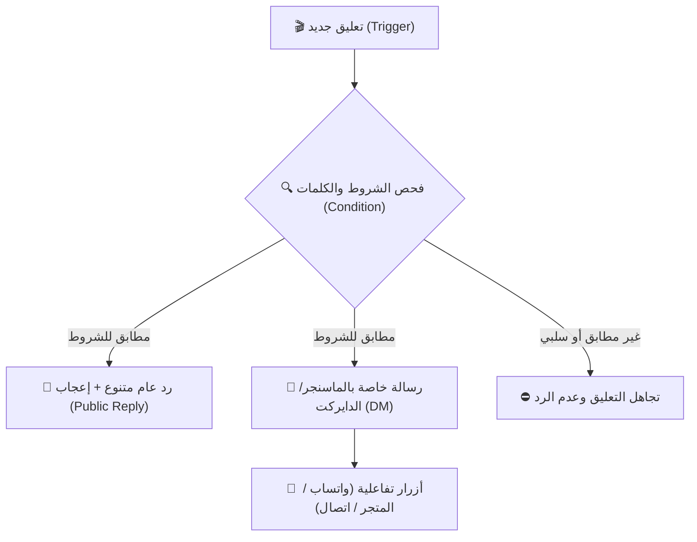

# 🚀 دليل محرر المسارات البصري المتقدم (Flow Builder) — منصة AnyChat

يقدم محرر المسارات التفاعلي في **AnyChat** تجربة أتمتة شاملة مستوحاة من منصة ManyChat العالمية، ومصممة خصيصاً للغة العربية ودعم اتجاه النص من اليمين إلى اليسار (RTL). يتيح المحرر لأصحاب المتاجر والمشاريع الرقمية بناء مسارات رد تلقائي على تعليقات فيسبوك وإنستغرام، وتحويل المعلقين إلى مشترين عبر رسائل خاصة تفاعلية فورية.

---

## 📑 فهرس المحتويات
1. [نظرة عامة على المحرر](#-نظرة-عامة-على-المحرر)
2. [استخدام القوالب الجاهزة (Flow Templates)](#-استخدام-القوالب-الجاهزة)
3. [محاكي الموبايل التفاعلي المباشر (Phone Preview)](#-محاكي-الموبايل-التفاعلي-المباشر)
4. [ميزات الأتمتة المتقدمة (ManyChat-Grade)](#-ميزات-الأتمتة-المتقدمة)
   - [تنويع صيغ الردود (Multi-Reply Variations)](#تنويع-صيغ-الردود)
   - [الإعجاب التلقائي بالتعليق (Auto-Like)](#الإعجاب-التلقائي)
   - [استثناء الكلمات السلبية (Negative Keywords)](#استثناء-الكلمات-السلبية)
   - [الأزرار التفاعلية (Action Buttons)](#الأزرار-التفاعلية)
   - [تخصيص بيانات المنشور واسم العميل](#تخصيص-بيانات-المنشور-واسم-العميل)
5. [الترتيب والتنظيم التلقائي (Auto-Layout)](#-الترتيب-والتنظيم-التلقائي)
6. [الاختبار والمحاكاة التجريبية (Simulator)](#-الاختبار-والمحاكاة-التجريبية)
7. [معايير إمكانية الوصول والتصميم الشامل (Accessibility & RTL)](#-معايير-إمكانية-الوصول-والتصميم)

---

## 🧭 نظرة عامة على المحرر

يعتمد محرر مسارات AnyChat على شبكة تفاعلية مبنية بأحدث تقنيات React Flow، مع عقد مخصصة ومصنفة لتلائم احتياجات الأتمتة:
- **عقدة البداية (Trigger Node - `trigger.comment`)**: تلتقط التعليقات على منشورات فيسبوك وإنستغرام بناءً على نطاق محدد (كافة المنشورات، منشورات محددة، أو مقاطع الريلز فقط).
- **عقدة الشروط الذكية (Condition Node - `condition.text`)**: تفحص نص التعليق ومطابقته للكلمات المفتاحية (يحتوي، يبدأ بـ، يطابق تماماً، regex) أو فئات جاهزة كاستفسارات الأسعار والعناوين.
- **عقدة الرد العام (Public Reply - `action.public_reply`)**: تضع رداً عاماً على التعليق مع خيار تنويع الصيغ عشوائياً وتفعيل الإعجاب التلقائي بالتعليق.
- **عقدة الرسالة الخاصة (Private Reply - `action.private_reply`)**: ترسل رسالة خاصة مباشرة لصندوق بريد المعلق (Messenger / Instagram DM) تتضمن تفاصيل العرض، الروابط، الصور، والأزرار التفاعلية.

---

## ⚡ استخدام القوالب الجاهزة

للبدء الفوري دون الحاجة لرسم المخططات من الصفر، يوفر المحرر نافذة **قوالب أتمتة ManyChat الجاهزة (`FlowTemplatesModal`)**:

### خطوات الاستخدام:
1. انقر على زر **⚡ قوالب جاهزة (ManyChat)** في شريط الأدوات العلوي للمحرر.
2. تصفح القوالب المصنفة:
   - **استفسارات الأسعار والطلب المباشر**: جاهز للرد على استفسارات الأسعار وإرسال تفاصيل السعر مع زر الطلب وزر محادثة واتساب.
   - **حملة كود الخصم والكوبونات**: إرسال قسائم الشراء والهدايا تلقائياً لمن يعلق بكلمة (خصم، كود، برومو).
   - **الرد الشامل الذكي على جميع المنشورات**: أتمتة عامة ترحب بجميع المعلقين وتوجههم لرسائل الصفحة.
   - **تحويل المتابعين إلى محادثة واتساب**: توجيه فوري للعملاء من تعليقات السوشيال ميديا لمحادثة واتساب مبيعات.
   - **إرسال كتالوج المنتجات وقائمة الأسعار**: إرفاق رابط الكتالوج أو صور المنتجات مع أزرار التنقل.
3. اضغط على زر **استخدام هذا القالب الآن**.
4. سيتم تحميل وتوصيل كافة العقد تلقائياً وتفعيل المحاكي المباشر.

---

## 📱 محاكي الموبايل التفاعلي المباشر (Phone Preview)

يتيح لك المحاكي المدمج في اللوحة الجانبية رؤية النتيجة تماماً كما ستظهر على هاتف العميل بالريال تايم:
- **تبديل المنشور (Post Preview)**: استعراض صورة المنشور، نص البوست، والتعليقات الواردة مع الرد العام وردود التفاعل.
- **تبديل الرسائل الخاصة (DM Preview)**: استعراض شكل رسالة الخاص، اسم المتجر الموثق، نص الرسالة المنسق مع المتغيرات الديناميكية، والصور المرفقة، والأزرار التفاعلية.
- **تجربة حية تفاعلية**: خانة إدخال سريعة أسفل المحاكي لكتابة أي تعليق واختبار استبدال المتغيرات وتغير شكل الرد لحظياً.

---

## 💎 ميزات الأتمتة المتقدمة (ManyChat-Grade)

### تنويع صيغ الردود
لمنع حظر حساباتك أو تقييد الردود من خوارزميات ميتا (Anti-Spam Guard)، يمكنك إضافة حتى 5 صيغ مختلفة للرد العام. يقوم محرك الأتمتة باختيار صيغة عشوائية لكل عميل تلقائياً.

### الإعجاب التلقائي
تفعيل خيار `Auto-Like` يضع إعجاباً فورياً على تعليق العميل كخطوة أولى قبل الرد، مما يرفع تقييم التفاعل (Engagement Rate) في خوارزميات فيسبوك وإنستغرام.

### استثناء الكلمات السلبية
من خلال مكوّن `NegativeKeywordInput`، يمكنك إضافة كلمات تمنع تشغيل الأتمتة (مثل: "نصابين"، "غالي"، "شكوى"، "سيء"). يوفر المكون اقتراحات شائعة بنقرة واحدة وإمكانية إضافة أو حذف الكلمات بسهولة.

### الأزرار التفاعلية
باستخدام مكوّن `ActionButtonsManager`، يمكنك إضافة ما يصل إلى 3 أزرار أسفل الرسالة الخاصة:
1. **🔗 رابط موقع (URL)**: توجيه العميل لصفحة المنتج أو إتمام الطلب بالمتجر.
2. **💬 واتساب (WhatsApp)**: فتح محادثة واتساب مباشرة مع رقم خدمة العملاء أو المبيعات.
3. **📞 اتصال هاتفي**: فتح تطبيق الهاتف للاتصال المباشر بنقرة واحدة.

### تخصيص بيانات المنشور واسم العميل
- **رفع صورة المنشور**: يدعم رفع صورة أو بانر الإعلان مباشرة (`input[type="file"]`) لمعاينتها فورياً بالمحاكي وتخزينها عبر مسار `/api/post/metadata`.
- **اسم العميل**: إمكانية إدخال اسم عميل مخصص للتجربة وفحص دمج المتغيرات النصية (`{{commenter_name}}`).

---

## 🪄 الترتيب والتنظيم التلقائي (Auto-Layout)

تعتمد خوارزمية `autoLayoutNodes` على هيكلية شجرية مستوية (Hierarchical Tree Layout):
- فحص العقد الجذرية (عقد البدء `trigger.comment`).
- توزيع العقد المتسلسلة رأسياً من الأعلى للأسفل بمستويات مدروسة (`Level Height = 170px`).
- موازنة العقد أفقياً لمنع أي تداخل بصري وتوفير مسافات كافية للأسهم والمقابض التفاعلية.

---

## 🧪 الاختبار والمحاكاة التجريبية

قبل نشر المسار على صفحتك الرسمية:
1. انقر على زر **اختبار ومحاكاة** في شريط الأدوات.
2. اكتب نص التعليق الذي ترغب باختباره (مثال: "بكام الطقم ده؟").
3. اضغط على **تشغيل المحاكاة**.
4. استعرض تقرير التتبع (Execution Trace) خطوة بخطوة:
   - فحص شروط الكلمات المفتاحية (`passed` / `failed`).
   - تجهيز صيغة الرد العام.
   - تجهيز نص وصور الرسالة الخاصة والأزرار التفاعلية.

---

## ♿ معايير إمكانية الوصول والتصميم الشامل

- **توافق RTL كامل**: واجهة معربة بنسبة 100% متوافقة مع خط **Thmanyah Sans**.
- **معايير WCAG**: تباين ألوان يفوق 4.5:1 للنصوص والأزرار وعناصر التحكم.
- **سهولة الوصول بلوحة المفاتيح**: كافة النوافذ المنبثقة مزودة بـ `role="dialog"` و`aria-modal="true"` وإمكانية الإغلاق بزر `Escape` والتركيز التلقائي على العناصر التفاعلية.
