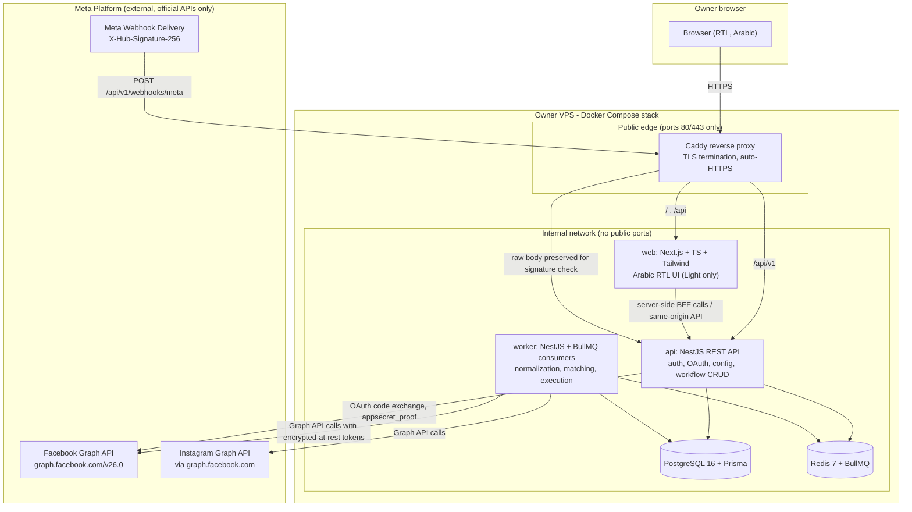
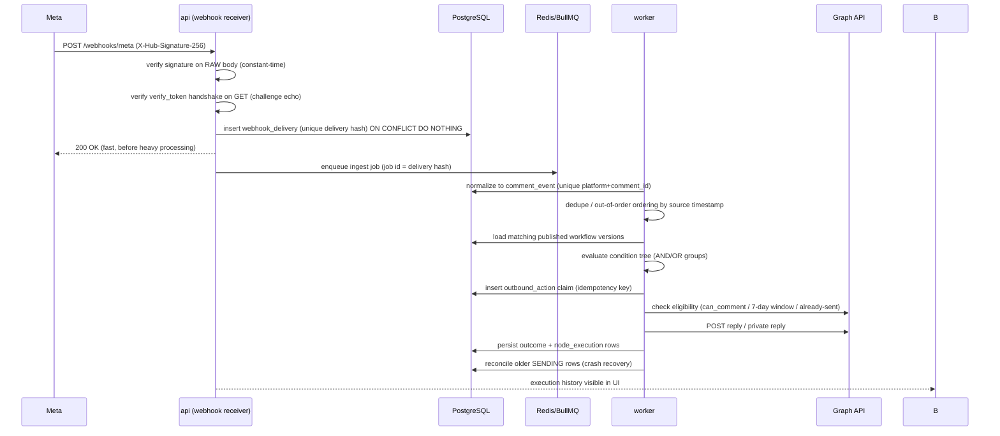
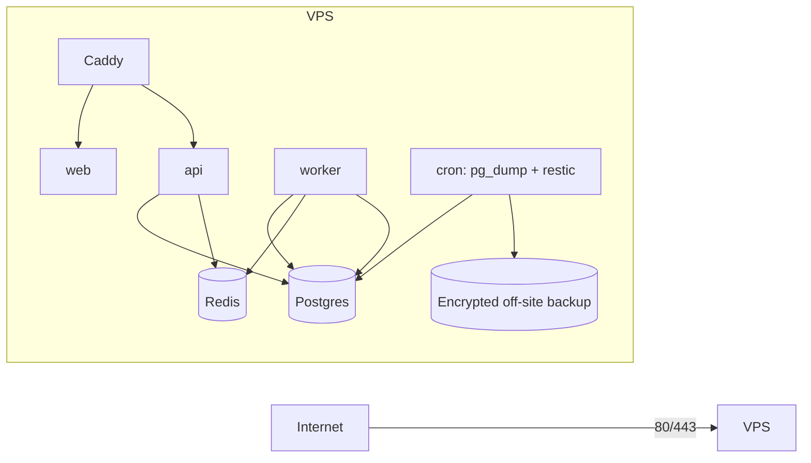

# Phase 0 — Architecture & Feasibility Study
# Single-Owner Meta Automation Platform

- **Status:** Awaiting owner approval. **No application code has been written.**
- **Date:** 2026-10-22
- **Graph API version referenced:** `v26.0` (released 2026-07-29; `v25.0` available until 2028-07-29)
- **Research basis:** Official Meta developer documentation only (URLs cited per claim).
- **Repository state at start of Phase 0:** empty directory, no git repository, no existing files.

---

## How to read the classification labels

Every Meta-facing capability in this report carries exactly one label:

| Label | Meaning |
|---|---|
| **CONFIRMED** | Documented by current official Meta documentation; the endpoint/permission pair exists and is described as supported. |
| **CONDITIONAL** | Documented, but usable only if a specific access level, approval, task, account type, or eligibility condition is met. |
| **UNRESOLVED** | Official documentation is internally conflicting, ambiguous, or silent; must be verified empirically in the owner's App Dashboard / with a live test before it can be planned as a feature. |
| **UNSUPPORTED** | Documented as removed, deprecated, or not available for this use case. Do not build on it. |

**Standing rule:** a CONFIRMED label means "the documentation says so", **not** "the owner's app already has this permission". Verified Business account status and Tech Provider status are **not** treated as proof of any granted permission, access level, or approval.

---

## 1. Executive Summary

This project is a private, self-hosted, single-user automation platform in the ManyChat spirit, restricted to:

- Facebook Page comment events → keyword triggers → public comment replies and (where eligible) private replies.
- Instagram professional account comment events → keyword triggers → public comment replies and (where eligible) private replies.

The system runs on the owner's VPS as a Docker Compose stack, has exactly one administrative user (the owner), an Arabic-only RTL interface, Light Mode only, and a native backend workflow engine (no n8n).

**Feasibility verdict: FEASIBLE WITH DOCUMENTED RISKS.** The core read/reply loop for both Facebook and Instagram is documented by Meta and can be built with official APIs only. Three risk clusters dominate:

1. **Access level and App Review risk (highest).** Instagram comment **webhook** delivery is documented as requiring **Advanced Access** for `comments`/`live_comments` notifications, and Advanced Access requires App Review + Business Verification. Other documentation states that an app serving only a business the owner owns needs only Standard Access with **no App Review**. Both statements are current; they are not obviously reconcilable from documentation alone. This must be resolved empirically in the App Dashboard in Phase 2 before workflow-engine work begins (Section 15, Q1–Q3).
2. **Private reply permission conflict.** Two current Meta documents list **different permission sets and endpoints** for Instagram private replies (`pages_messaging` + `POST /{page-id}/messages` + Human Agent + Advanced Access, versus `instagram_manage_comments` + `pages_read_engagement` + `POST /{ig-user-id}/messages`). Must be resolved with a live test (Section 6.4).
3. **Delivery guarantees.** Meta webhooks are at-least-once with retries, duplicates, and out-of-order delivery. The design therefore claims **at-least-once processing with idempotent, reconciled outbound actions** — never "exactly once remote delivery" (Section 9).

Stack evaluation (Section 5) adopts the proposed stack with two adjustments for single-operator simplicity: **Caddy** as the HTTPS reverse proxy (automatic certificates) and a **pnpm monorepo** shared between web/api/worker. n8n remains rejected; the workflow engine is native.

**Gate:** Phase 1 must not start until the owner explicitly approves this report and answers the owner-input questions in Section 15.

---

## 2. Product Scope and Non-Goals

### 2.1 In scope (initial product)

| # | Capability |
|---|---|
| S1 | Single administrative identity (the owner): login, session management, logout, password recovery/recovery strategy, brute-force protection. |
| S2 | Official Meta OAuth connection ("Connect with Facebook"), with advanced settings for App ID / App Secret / webhook verify token / API version. |
| S3 | Discovery and selection of Facebook Pages and eligible Instagram professional accounts linked to those Pages. |
| S4 | Connection status, granted-permission display, token lifecycle (expiry, debug, reconnection), webhook subscription status/diagnostics. |
| S5 | Ingestion of Facebook Page comments and Instagram comments via official webhooks (+ documented backfill/poll for reconciliation). |
| S6 | Posts/reels inventory for connected assets; trigger scoping to a specific post or all posts of an asset. |
| S7 | Keyword/phrase triggers with condition groups (contains, exact, excludes, case sensitivity, AND/OR), asset/post filters, duplicate-event checks, action-eligibility checks. |
| S8 | Actions: public comment reply; eligible private reply; reusable message templates; dynamic variables (allow-listed only); stop-workflow; execution logging. |
| S9 | Node-based visual workflow builder (React Flow) with validation, draft/published versions, pause/resume, node configuration, execution inspection, safe error handling. |
| S10 | Execution history, outbound action records, structured audit logs for sensitive configuration changes. |
| S11 | Arabic-only RTL UI (IBM Plex Sans Arabic, Light Mode only) across the ten planned pages (Section 10.1). |
| S12 | Self-hosted Docker deployment with HTTPS, health checks, structured logs, automated backups, tested restore, deploy/rollback docs. |

### 2.2 Explicit non-goals

- No multi-user support of any kind: no invitations, no roles, no teams, no per-user permissions, no subscription/billing tables.
- No scraping, unofficial APIs, browser automation, or workarounds for Meta permissions.
- No n8n or external automation runtime as the core engine.
- No Dark Mode, no English/localization switch (owner-facing text is Arabic only).
- No sending of messages outside documented Meta surfaces (no cold DM blasts, no Sponsored Messages, no broadcast lists).
- No aggregation of other people's data, no cross-account analytics product, no public SaaS tenancy.
- No mobile app; responsive web only.
- No claim of exactly-once delivery to Meta; no claim that any capability works beyond what current official documentation states.
- Phase 0 delivers planning and research only — no application features are implemented in this phase.

### 2.3 Data minimization principle

Commenter personal data is minimized by design: store platform comment ID, masked author reference (platform-scoped ID, never full profile data), comment text (needed for keyword matching), post reference, timestamps, and event metadata. Do **not** store commenter profile pictures, email addresses, phone numbers, or derived demographic data. Retention policies are defined in Section 4.4.

---

## 3. Architecture Diagram

### 3.1 System architecture (Mermaid)



### 3.2 Event lifecycle (sequence)



### 3.3 Deployment topology



Only `80/tcp` and `443/tcp` are published. Postgres (5432), Redis (6379), and all app ports stay on the internal Compose network (justified in Section 11.1).

---

## 4. Database Design

### 4.1 ER diagram (Mermaid)

```mermaid
erDiagram
    OWNER_ACCOUNT ||--o{ OWNER_SESSION : has
    OWNER_ACCOUNT ||--o{ PASSWORD_RECOVERY : has
    OWNER_ACCOUNT ||--o{ AUDIT_LOG : generates

    SYSTEM_SETTING ||--o{ AUDIT_LOG : "config change"

    META_APP_CONFIG ||--|| AUDIT_LOG : "rotated via"
    META_APP_CONFIG ||--o{ WEBHOOK_SUBSCRIPTION : configures

    META_CONNECTED_ASSET ||--o| META_CREDENTIAL : "holds token ref"
    META_CONNECTED_ASSET ||--o{ POST : owns
    META_CONNECTED_ASSET ||--o{ WEBHOOK_SUBSCRIPTION : installs
    META_CONNECTED_ASSET ||--o{ WORKFLOW : scoped_by

    POST ||--o{ COMMENT_EVENT : contains
    META_CONNECTED_ASSET ||--o{ COMMENT_EVENT : receives
    WEBHOOK_DELIVERY ||--o{ COMMENT_EVENT : "normalizes into"
    META_APP_CONFIG ||--o{ WEBHOOK_DELIVERY : "signature verified with"

    WORKFLOW ||--o{ WORKFLOW_VERSION : versions
    WORKFLOW_VERSION ||--o{ EXECUTION_RUN : "pinned into"
    WORKFLOW ||--o{ MESSAGE_TEMPLATE : "may use"

    COMMENT_EVENT ||--o{ EXECUTION_RUN : triggers
    EXECUTION_RUN ||--o{ NODE_EXECUTION : has
    EXECUTION_RUN ||--o{ OUTBOUND_ACTION : produces

    META_CREDENTIAL {
        uuid id PK
        uuid asset_id FK
        text ciphertext "AES-256-GCM blob"
        text nonce
        text key_version
        jsonb granted_scopes
        timestamptz expires_at
        timestamptz last_validated_at
        text status "active|expired|revoked|reauth_required"
    }
    OWNER_ACCOUNT {
        uuid id PK
        text username
        text password_hash "argon2id"
        timestamptz password_changed_at
        timestamptz locked_until
        int failed_login_count
        timestamptz created_at
    }
    OWNER_SESSION {
        uuid id PK
        uuid owner_id FK
        text token_hash "sha256 of opaque token"
        timestamptz expires_at
        timestamptz last_seen_at
        text ip
        text user_agent
        timestamptz revoked_at
    }
    META_APP_CONFIG {
        uuid id PK
        text app_id
        text app_secret_cipher
        text webhook_verify_token_cipher
        text graph_api_version
        text appsecret_proof_enabled
        timestamptz rotated_at
    }
    META_CONNECTED_ASSET {
        uuid id PK
        text platform "facebook|instagram"
        text external_id "Page ID or IG business account ID"
        text display_name
        text linked_page_id "for IG assets"
        jsonb permissions_granted
        text connection_status
        timestamptz connected_at
        timestamptz last_health_check_at
    }
    WEBHOOK_SUBSCRIPTION {
        uuid id PK
        uuid asset_id FK
        text object "page|instagram"
        jsonb subscribed_fields
        text subscription_status
        timestamptz last_event_at
        timestamptz last_verified_at
        jsonb diagnostics
    }
    POST {
        uuid id PK
        uuid asset_id FK
        text external_id
        text platform
        text message_preview
        timestamptz created_time
        text permalink
        bool is_eligible_for_reply
        timestamptz synced_at
    }
    COMMENT_EVENT {
        uuid id PK
        uuid asset_id FK
        uuid post_id FK
        text platform
        text external_comment_id
        text parent_comment_id
        text author_scoped_id
        text author_username
        text text
        timestamptz source_created_at
        text raw_payload_ref "webhook_delivery.id"
        text dedupe_key "unique"
        timestamptz received_at
        text direction "inbound"
    }
    WORKFLOW {
        uuid id PK
        uuid asset_id FK "nullable = all assets"
        text name
        text status "draft|published|paused"
        int current_version
        int lock_version "optimistic concurrency"
        timestamptz created_at
        timestamptz updated_at
    }
    WORKFLOW_VERSION {
        uuid id PK
        uuid workflow_id FK
        int version
        jsonb definition "validated workflow JSON"
        text state "draft|published|archived"
        text published_note
        timestamptz published_at
    }
    EXECUTION_RUN {
        uuid id PK
        uuid workflow_version_id FK
        uuid comment_event_id FK
        text status "pending|running|succeeded|failed|stopped|skipped"
        text skip_reason
        jsonb context_snapshot
        timestamptz started_at
        timestamptz finished_at
        int attempt
    }
    NODE_EXECUTION {
        uuid id PK
        uuid run_id FK
        text node_id
        text node_type
        text status
        jsonb input_summary
        jsonb output_summary
        text error_code
        text error_message
        timestamptz started_at
        timestamptz finished_at
    }
    OUTBOUND_ACTION {
        uuid id PK
        uuid run_id FK
        text action_type "public_reply|private_reply"
        text idempotency_key "unique"
        text target_comment_id
        text rendered_message
        text status "pending|sending|sent|failed|skipped|unknown"
        text remote_message_id
        text fencing_token
        int attempt_count
        timestamptz claimed_at
        timestamptz sent_at
        text last_error_code
        timestamptz reconciled_at
    }
    MESSAGE_TEMPLATE {
        uuid id PK
        text name
        text body
        jsonb allowed_variables
        int version
        timestamptz updated_at
    }
    AUDIT_LOG {
        uuid id PK
        text actor "owner|system|worker"
        text action
        text target_type
        text target_id
        jsonb change_summary "secrets redacted"
        text ip
        timestamptz created_at
    }
    WEBHOOK_DELIVERY {
        uuid id PK
        text delivery_hash "unique"
        text object_type
        jsonb payload
        text signature_status
        timestamptz received_at
        text process_status
    }
    SYSTEM_SETTING {
        text key PK
        jsonb value
        timestamptz updated_at
    }
    PASSWORD_RECOVERY {
        uuid id PK
        uuid owner_id FK
        text token_hash
        timestamptz expires_at
        timestamptz used_at
    }
```



### 4.2 Design decisions

1. **No team/invitation/role/subscription tables.** The only human record is `OWNER_ACCOUNT`. Extensibility beyond single-tenancy is deliberately deferred; adding tenancy later would require a `tenant_id` migration, accepted as future cost.
2. **Workflow definitions are validated JSON documents** (`WORKFLOW_VERSION.definition`), not per-node rows. Rationale: the graph is always read/written as a whole; a single document gives atomic publish, trivial version snapshots, and one JSON Schema validation point. Node-level querying is served from the JSONB, not needed relationally.
3. **Draft vs published is a version row, not a column on the graph.** `state=draft` rows are mutable; `state=published` rows are immutable after publish. Runs always pin an immutable `workflow_version_id`, so editing a workflow never changes the semantics of historical runs.
4. **Credentials split:** `META_APP_CONFIG` holds *global application configuration* (App ID, App Secret, verify token, API version) — one row; `META_CREDENTIAL` holds *per-asset tokens*. Secrets are ciphertext only; no API response ever returns a decrypted secret after save (Section 7).
5. **`WEBHOOK_DELIVERY` before `COMMENT_EVENT`:** raw payloads are stored first (durable event storage), normalization is a separate idempotent step, which makes replay/debugging possible after Meta-side or local failures.

### 4.3 Indexing and integrity highlights

- `COMMENT_EVENT.dedupe_key` UNIQUE (`platform:external_comment_id:event_kind`).
- `WEBHOOK_DELIVERY.delivery_hash` UNIQUE (hash of object + entry id + field + value id + time + verb).
- `OUTBOUND_ACTION.idempotency_key` UNIQUE (`run_id:action_type:target_comment_id`).
- Partial index on `OUTBOUND_ACTION(status)` for `sending` rows older than N minutes (reconciliation scan).
- `EXECUTION_RUN(workflow_version_id, started_at DESC)` for history views; `COMMENT_EVENT(asset_id, source_created_at)` for post-scoped queries.
- FKs with `ON DELETE RESTRICT` for workflow versions referenced by runs; `ON DELETE CASCADE` only for session/recovery rows of the owner.

### 4.4 Retention and deletion policy (draft — owner must confirm, Section 15 Q9)

| Data | Proposed retention | Rationale |
|---|---|---|
| `WEBHOOK_DELIVERY.payload` | 30 days | Debug window for webhook issues; contains commenter text. |
| `COMMENT_EVENT` (text + author_scoped_id) | 180 days, then null text/author, keep ID + timestamps for idempotency | Minimizes personal data while preserving dedupe. |
| `NODE_EXECUTION.input_summary/output_summary` | 180 days | Troubleshooting window. |
| `OUTBOUND_ACTION.rendered_message` | 180 days | Audit of what was sent. |
| `OWNER_SESSION` | sliding 7d idle expiry; rows deleted after 30d | Security. |
| `AUDIT_LOG` | 400 days | Security/compliance history. |
| Backups | 30 days rolling (encrypted, off-site) | Restore capability. |
| Deletion | on-demand purge endpoint for a comment event + nightly job applying retention | Owner-requested deletion. |

---

## 5. Stack Evaluation

The proposed stack was evaluated against the real constraints: **one owner, one VPS, long-term self-maintenance, official-API-only integration, RTL Arabic UI, visual workflow editing.**

| Layer | Candidate | Verdict | Reasoning |
|---|---|---|---|
| Frontend framework | Next.js (App Router) + React + TypeScript | **Adopt** | Mature RTL/`dir="rtl"` support, SSR for fast first paint of the Arabic UI, first-class TS, huge ecosystem. Complexity cost of App Router is acceptable. |
| Styling | Tailwind CSS | **Adopt** | Fits Light-Mode-only design tokens; RTL handled with logical properties (`ms-`/`me-`/`ps-`/`pe-`). |
| Font | IBM Plex Sans Arabic | **Adopt** | Required; self-host the woff2 files (no third-party font CDN dependency at runtime). |
| Backend | NestJS | **Adopt** | Gives structure for guards (admin authorization), interceptors (audit logging, redaction), modular boundaries (auth/meta/workflow/webhook), and DI for testability. Heavier than plain Express/Fastify, but the structure pays off for a phased build maintained by AI-assisted development. |
| ORM/DB | PostgreSQL + Prisma | **Adopt** | JSONB for workflow documents, advisory locks, strong migrations; Prisma's type-safe client matches the TS stack. Requires careful use of `$queryRaw` for `ON CONFLICT` idempotency paths (supported). |
| Queue | Redis + BullMQ | **Adopt** | Retries with backoff, delayed jobs (private-reply timing), job dedup via deterministic jobId, stalled-job recovery for worker crashes. Redis data is disposable (queue state can be rebuilt) → simplifies backups. |
| Workflow editor | React Flow | **Adopt** | Node/edge canvas with validation hooks, custom nodes, RTL layout support (canvas coordinates are LTR-neutral; node content is RTL). Backend remains the source of truth for execution. |
| Workflow engine | Native backend engine | **Adopt (required)** | Full control over idempotency, eligibility gates, execution history, and Meta-specific error handling. |
| Workflow runtime | n8n | **Reject (required decision)** | Extra service, external state, weaker control over idempotency/audit; contradicts confirmed decision. |
| Reverse proxy | nginx / Traefik / Caddy | **Caddy (adjustment)** | Automatic Let's Encrypt issuance/renewal with 2 lines of config; single-operator friendly. Traefik is fine but more moving parts; nginx needs certbot automation. |
| Monorepo | npm/yarn vs pnpm workspaces | **pnpm workspaces (+ Turborepo optional)** | One repo `apps/web`, `apps/api`, `apps/worker`, `packages/shared` (workflow JSON Schema, zod types, Arabic i18n strings shared by web/api). |
| Process layout | single API process vs API+worker split | **API + separate worker** | Webhook receiver must stay responsive while Graph API calls execute; independent scaling and crash isolation. Both run the same NestJS codebase with different entrypoints. |
| Auth | next-auth vs custom | **Custom session auth in NestJS** | Single user; opaque random session tokens stored hashed; avoids coupling frontend to an auth provider and keeps authorization checks server-side (Section 7.3). |
| Monitoring | Prometheus/Grafana stack vs lightweight | **Lightweight first: `/healthz` + structured JSON logs + optional Uptime Kuma container** | One-owner operability; full metrics stack deferred unless needed. |

**Complexity check for a single operator:** 6 containers (caddy, web, api, worker, postgres, redis) + optional monitor/backup sidecar. All state lives in two volumes (postgres data, caddy certs) plus off-site backups. This is maintainable by one person with documented runbooks (Section 11).

### 5.1 Repository and module structure

```
anychat/
├── apps/
│   ├── web/                     # Next.js (App Router), Arabic RTL, Light Mode only
│   │   └── src/
│   │       ├── app/             # routes: login, dashboard, connections, posts,
│   │       │                    #   workflows, workflows/[id]/builder, templates,
│   │       │                    #   runs, settings, audit
│   │       ├── components/      # ui/, layout/, workflow/ (React Flow nodes, inspector)
│   │       └── lib/             # api client (same-origin), csrf helper, rtl utils
│   ├── api/                     # NestJS HTTP entrypoint
│   │   └── src/
│   │       ├── main.ts          # raw-body capture registered BEFORE json parsing
│   │       │                    #   (required for webhook HMAC verification)
│   │       ├── modules/
│   │       │   ├── auth/        # login, session, logout, recovery, lockout, csrf
│   │       │   ├── meta/        # oauth start/callback, asset discovery & selection,
│   │       │   │                #   credential store, advanced app config, token health
│   │       │   ├── webhooks/    # hub verification, signature check, delivery store,
│   │       │   │                #   subscription mgmt, diagnostics API
│   │       │   ├── content/     # posts, comment events (read views)
│   │       │   ├── workflows/   # CRUD, versions, validation, publish/pause/resume
│   │       │   ├── templates/   # message templates + variable registry
│   │       │   ├── runs/        # execution history, node executions, outbound actions
│   │       │   ├── audit/       # audit writer + query API
│   │       │   ├── settings/    # system settings, retention, key status
│   │       │   └── health/      # /healthz, /readyz, /metrics
│   │       └── common/          # AdminAuthGuard, interceptors (redact, audit),
│   │                            # exception filters (Arabic-safe error contract)
│   └── worker/                  # NestJS BullMQ consumers (same domain modules,
│                                #   different entrypoint: no HTTP routes except health)
│       └── queues/              # ingest, reconcile, match, execute, maintain
├── packages/
│   ├── shared/                  # workflow zod schema + JSON Schema, node contracts,
│   │                            #   meta error taxonomy, i18n/ar.ts, env schema
│   └── config/                  # tsconfig, eslint, tailwind preset
├── deploy/                      # docker-compose.yml, Caddyfile, runbooks, backup scripts
├── docs/                        # this report and later phase reports
└── .env.example                 # placeholders only
```

### 5.2 API boundaries (route surface and process rules)

| Surface | Auth | Contents |
|---|---|---|
| `POST /api/v1/auth/login` \| `logout` \| `GET session` \| `POST recovery/*` | login/recovery rate-limited; session cookie otherwise | owner identity only |
| `GET/PUT /api/v1/meta/config` | admin | App ID, App Secret (write-only), verify token (write-only), API version |
| `GET /api/v1/meta/oauth/start` → `GET .../oauth/callback` | admin + OAuth state/PKCE | official connection flow |
| `GET /api/v1/meta/assets` \| `POST .../select` \| `DELETE .../:id` \| `POST .../reconnect` | admin | Page/IG discovery and connection lifecycle |
| `GET /api/v1/meta/assets/:id/health` \| `GET .../webhooks/diagnostics` | admin | token status, scopes, expiry, subscription status, signature-failure counters |
| `POST /api/v1/webhooks/meta` | **HMAC signature + verify token** (no session) | Meta webhook receiver; store + enqueue only |
| `GET /api/v1/posts` \| `GET /api/v1/comments` | admin | content views |
| `POST/GET/PATCH /api/v1/workflows` \| `POST .../:id/publish` \| `POST .../:id/pause` \| `POST .../:id/test` | admin | authoring; publish enforces validation |
| `GET/POST/PATCH/DELETE /api/v1/templates` | admin | templates |
| `GET /api/v1/runs` \| `GET /api/v1/runs/:id` \| `POST .../retry` | admin | history + node inspector |
| `GET /api/v1/audit` \| `GET/PUT /api/v1/settings` | admin | audit query, retention, password change |
| `/healthz` \| `/readyz` \| `/metrics` | none (no sensitive data) | ops probes |

**Process boundary rules (enforced by module ownership + tests):**

1. **The frontend never calls Meta.** No Graph API credentials or calls in `apps/web`; it talks only to our API (same-origin).
2. **Graph API execution lives in exactly two places:** the `meta` OAuth module (code exchange, discovery, token debug) in `api`, and the `execute`/`maintain` queues in `worker`. No other module imports the Graph client.
3. **The API never performs action sends inline:** action requests are enqueued; responses return `202` with a run/job reference.
4. **The webhook route is the only unauthenticated write surface** and is HMAC-gated; everything else requires the admin session.
5. **Worker has no public HTTP surface** (health only) and cannot be reached from the edge network.

---

## 6. Meta Capability, Endpoint, and Permission Matrix

All rows cite current official documentation. Where two official documents disagree, both are cited and the row is labeled **UNRESOLVED**.

### 6.1 Facebook — comment ingestion and public replies

| Capability | Endpoint / mechanism | Permissions (as documented) | Conditions | Class | Source |
|---|---|---|---|---|---|
| List Pages the owner manages | `GET /{user-id}/accounts` | `pages_show_list` (+ `pages_read_engagement` for page data); user token | Owner must have a task on the Page | CONFIRMED | [Pages API overview](https://developers.facebook.com/docs/pages-api/), [Manage a Page](https://developers.facebook.com/docs/pages-api/manage-pages) |
| Read comments on a Page post | `GET /{page-post-id}/comments` | Same permissions as viewing the parent object: `pages_read_engagement` (Pages API overview summarizes comment read under `pages_manage_engagement`); Page access token | Comment `id` field requires the token holder to have the **MODERATE** task (v11.0+ rule, applies to all versions since 2021-09-07); `filter=toplevel\|stream`, `order` params; max paging limits on very large threads | CONFIRMED | [Page Post Comments](https://developers.facebook.com/docs/graph-api/reference/page-post/comments/), [Object Comments](https://developers.facebook.com/docs/graph-api/reference/v25.0/object/comments), [Pages API overview](https://developers.facebook.com/docs/pages-api/) |
| List posts of a Page | `GET /{page-id}/feed` | `pages_read_engagement` (+ `pages_manage_posts` for publishing) | — | CONFIRMED | [Pages API overview](https://developers.facebook.com/docs/pages-api/) |
| Public reply to a comment (comment on comment) | `POST /{comment-or-post-id}/comments` with `message` | **`pages_manage_engagement`**, Page access token from a person with **MODERATE** task | `can_comment` field on the Comment node indicates whether replying is possible — use as eligibility gate | CONFIRMED | [Object Comments – Publishing](https://developers.facebook.com/docs/graph-api/reference/v25.0/object/comments), [Comments and @mentions](https://developers.facebook.com/documentation/pages-api/comments-mentions) |
| Read comment author info | `from` field on comment | Page access token required for fields containing user info | Page-owned comments need Page token | CONFIRMED | [Comment node](https://developers.facebook.com/docs/graph-api/reference/v8.0/comment) |

### 6.2 Facebook — private replies (Messenger)

| Capability | Endpoint / mechanism | Permissions (as documented) | Conditions | Class | Source |
|---|---|---|---|---|---|
| Private reply to a comment | `POST /PAGE-ID/messages` with `recipient.comment_id` (or `post_id` for visitor posts) + `message.text` + `messaging_type` | **`pages_messaging`** + Page access token from a person who can perform the **MESSAGING** task | One message only; must be sent **within 7 days** of the comment; conversation continues only if the person responds (24h window); cannot private-reply to another Page; Standard Access apps can only access data for people who have a role on the app; group private replies require group setting enabled (default on) | CONDITIONAL | [Private replies – Messenger Platform](https://developers.facebook.com/documentation/business-messaging/messenger-platform/discovery/private-replies) (updated 2026-04-16), [Policy](https://developers.facebook.com/documentation/business-messaging/messenger-platform/policy) (7-day limit), [Send API](https://developers.facebook.com/docs/messenger-platform/reference/send-api) (`comment_id`/`post_id` recipient fields) |
| Legacy `POST /{object-id}/private_replies` edge | legacy edge | Legacy docs list `read_page_mailboxes` | One page notes "feature removed after Graph API v3.2" while the v26.0 reference page still renders the edge | **UNSUPPORTED** (do not build on it; superseded by Send API) | [private_replies reference (v3.3-era banner)](https://developers.facebook.com/docs/graph-api/reference/v3.3/object/private_replies) vs [v26.0 rendering](https://developers.facebook.com/docs/graph-api/reference/object/private_replies) |
| Webhook to detect comments | Page object, `feed` field | `pages_manage_metadata` + `pages_show_list`; Page access token from person with CREATE_CONTENT/MANAGE/MODERATE task | Page must install the app via `POST /{page-id}/subscribed_apps`; "Webhooks are not sent for Ad Posts, but are sent for Comments on Ad Posts"; comment payloads include `comment_id`, `post_id`, `item`, `verb`, `message`, `created_time` | CONFIRMED | [Webhooks for Pages](https://developers.facebook.com/docs/pages-api/webhooks-for-pages), [Webhooks Reference: Page](https://developers.facebook.com/docs/graph-api/webhooks/reference/page) |

### 6.3 Instagram — comment ingestion and public replies

> Design decision: use **Instagram API with Facebook Login** (Facebook Login for Business, `graph.facebook.com`), because the target Instagram accounts are professional accounts linked to a Facebook Page — this gives one OAuth flow covering both surfaces. The alternative (Instagram Login, `graph.instagram.com`) is documented but adds a second OAuth system. Owner confirmation: Section 15 Q4.

| Capability | Endpoint | Permissions (FB Login family) | Conditions | Class | Source |
|---|---|---|---|---|---|
| List media (posts/reels) of IG professional account | `GET /{ig-user-id}/media` | `instagram_basic` (+ Page-linked setup) | Account must be professional (business/creator); consumer accounts unsupported | CONFIRMED | [Instagram Platform overview](https://developers.facebook.com/docs/instagram-platform/instagram-graph-api/overview), [Comments edge (requirements table)](https://developers.facebook.com/documentation/instagram-platform/instagram-graph-api/reference/ig-media/comments) |
| Read comments on media | `GET /{ig-media-id}/comments` | `instagram_basic` + `instagram_manage_comments` (+ `pages_read_engagement` in the current matrix; + `ads_management` **or** `ads_read` if the app user's Page role was granted via Business Manager) | Max 50 comments/query; top-level only (replies need field expansion); reverse chronological default; `username` field requires `instagram_manage_comments` since 2024-08-27 | CONFIRMED | [IG Media Comments](https://developers.facebook.com/documentation/instagram-platform/instagram-graph-api/reference/ig-media/comments) |
| Public reply to a top-level comment | `POST /{ig-comment-id}/replies?message=...` (also `POST /{ig-media-id}/comments?message=...`) | `instagram_manage_comments` (+ `instagram_basic`, `pages_read_engagement` per matrix) | **Top-level comments only** — replies-to-replies attach to the top-level comment; cannot reply to hidden comments; cannot reply to live-video comments (use private reply) | CONFIRMED | [IG Comment Replies](https://developers.facebook.com/documentation/instagram-platform/instagram-graph-api/reference/ig-comment/replies), [IG Media Comments](https://developers.facebook.com/documentation/instagram-platform/instagram-graph-api/reference/ig-media/comments) |
| Hide / delete a comment (future use) | `POST /{ig-comment-id}?hide=true`, `DELETE /{ig-comment-id}` | `instagram_manage_comments` | Media owner only for delete; restricted users' comments hidden by default | CONFIRMED | [IG Comment](https://developers.facebook.com/documentation/instagram-platform/instagram-graph-api/reference/ig-comment) |
| Read comment author identity | `from.id` (IGSID), `from.username` | `instagram_manage_comments` for `username` (since 2024-08-27) | Minimize stored personal data | CONFIRMED | [IG Comment node](https://developers.facebook.com/documentation/instagram-platform/instagram-graph-api/reference/ig-comment) |

### 6.4 Instagram — private replies (**UNRESOLVED: conflicting official docs**)

| Source document | Endpoint | Permissions stated | Extra requirements stated |
|---|---|---|---|
| [Send a Private Reply to a Commenter – Instagram Platform](https://developers.facebook.com/documentation/instagram-platform/private-replies) (updated 2026-06-30) | `POST /{APP_USERS_IG_ID}/messages`, `recipient.comment_id` | FB Login: `instagram_basic`, `instagram_manage_comments`, `pages_read_engagement` (+ `ads_management`/`ads_read` if role via Business Manager). IG Login: `instagram_business_basic`, `instagram_business_manage_comments` | 7-day window; one message; live only during broadcast |
| [Private replies – Instagram Messaging](https://developers.facebook.com/documentation/business-messaging/instagram-messaging/features/private-replies) (updated 2026-07-02) | `POST /{PAGE_ID}/messages`, `recipient.comment_id` | `instagram_manage_comments` **and `pages_messaging`** via Facebook Login; Page access token from a person with **MESSAGING** task | **Human Agent feature**; **Advanced Access**; 7-day window; one message; 24h window only after the person responds |

| Capability | Class | Resolution plan |
|---|---|---|
| IG private reply on post/reel comment (within 7 days, one message, Inbox if follower / Request folder if not) | **UNRESOLVED** (feature documented; permission set and endpoint conflict between two current official docs) | Phase 2 spike: attempt both documented variants with the owner's app in a controlled test (see Section 14 Gate G2.4). Plan feature as conditional until one variant is proven. |
| IG private reply on Live comment | CONDITIONAL (documented only during live broadcast; 100 calls/sec/account rate limit noted) | Out of initial scope; no Live handling in Phases 1–6. |

### 6.5 Webhooks, verification, and delivery semantics

| Capability | Mechanism | Requirements | Class | Source |
|---|---|---|---|---|
| Verification handshake | `GET ?hub.mode=subscribe&hub.challenge=...&hub.verify_token=...` → echo challenge if token matches | HTTPS endpoint (valid cert, no self-signed), verify token configured in App Dashboard | CONFIRMED | [Webhooks getting started](https://developers.facebook.com/docs/graph-api/webhooks/getting-started) |
| Delivery signature | Header `X-Hub-Signature-256: sha256=<hex>`, HMAC-SHA256 over the **raw request body** with the **App Secret**; constant-time compare | Must capture raw bytes before JSON parsing; re-serializing breaks the HMAC | CONFIRMED | [Webhooks getting started (payload validation)](https://developers.facebook.com/docs/graph-api/webhooks/getting-started) |
| Page comment notifications | Page object, `feed` field | `pages_manage_metadata`, `pages_show_list`; per-Page subscription via `POST /{page-id}/subscribed_apps`; app must be installed on the Page | CONFIRMED | [Webhooks for Pages](https://developers.facebook.com/docs/pages-api/webhooks-for-pages) |
| Instagram comment notifications | Instagram object, `comments` field | `instagram_manage_comments` + `pages_manage_metadata`; account must be public (private accounts receive no comment notifications); ad-boosted posts may produce **duplicate notifications** (`ad_id`, `ad_title`, `original_media_id`) | CONFIRMED | [Webhooks for Instagram](https://developers.facebook.com/docs/graph-api/webhooks/getting-started/webhooks-for-instagram), [Instagram webhook examples](https://developers.facebook.com/docs/instagram-platform/webhooks/examples) |
| Advanced Access requirement for IG comment webhooks | Setup doc table lists "Advanced Access for comments and live_comments"; general docs say apps without Advanced Access on the permission do not receive webhook notifications; another current doc says development-mode apps receive only dashboard test notifications **or notifications initiated by people who have a role on the app** | Conflicting with the "single business I own → Standard Access, App Review not required" table | **UNRESOLVED** | [Set up Instagram Webhooks](https://developers.facebook.com/documentation/instagram-platform/webhooks/setup), [Webhooks for Instagram](https://developers.facebook.com/docs/graph-api/webhooks/getting-started/webhooks-for-instagram), [Webhooks from Meta](https://developers.facebook.com/docs/graph-api/webhooks), [App Review for Instagram API](https://developers.facebook.com/documentation/instagram-platform/app-review) |
| Retry / redelivery | Failed deliveries are retried by Meta; no ordering guarantee; no historical backfill (webhooks are not a store) | System must tolerate duplicates, out-of-order, and gaps → poll/reconcile via read endpoints | CONFIRMED (semantics) / gap-filling is our design | [Instagram Webhooks](https://developers.facebook.com/docs/instagram-platform/webhooks) ("handle duplicate deliveries… no historical notification store") |
| mTLS option | Meta may present a client certificate (CN `client.webhooks.fbclientcerts.com`) if mTLS enabled | Optional | CONFIRMED | [Instagram Webhooks setup](https://developers.facebook.com/docs/instagram-platform/webhooks) |

### 6.6 Access levels, App Review, tokens, rate limits, versioning

| Topic | Documented fact | Class | Source |
|---|---|---|---|
| Standard Access | Business apps are **automatically approved for Standard Access for all permissions and features**; usable by people with a role on the app | CONFIRMED | [Access Levels](https://developers.facebook.com/docs/graph-api/overview/access-levels/) |
| Advanced Access | Must be approved per-permission via App Review; **Business Verification required** (since 2023-02-01) | CONFIRMED | [Access Levels](https://developers.facebook.com/docs/graph-api/overview/access-levels/) |
| Single-business app | "My app is only for a business I own or manage" → Standard Access, **App Review not required** (Instagram App Review table) | CONFIRMED as written, but in tension with webhook Advanced Access statements | [App Review for Instagram API](https://developers.facebook.com/documentation/instagram-platform/app-review) |
| Live mode | Live apps can request permissions from anyone but only App Review–approved permissions are active; Development mode: any permission from role users; role users receive only test/dashboard webhook notifications in development mode (one current doc) vs "notifications initiated by people who have a role on the app" (another) | UNRESOLVED (webhook production delivery specifics) | [App Modes](https://developers.facebook.com/docs/development/build-and-test/app-modes/), [Webhooks from Meta](https://developers.facebook.com/docs/graph-api/webhooks) |
| Tech Provider | Access verification is required **only to access data owned by other businesses**; role users are exempt; independent of App Review | CONFIRMED | [Tech Providers](https://developers.facebook.com/docs/development/release/tech-providers) |
| Pages permissions & App Review | "All Page-related Permissions and Features require approval through App Review before your app can use them **when your app goes live**"; Development-mode apps can request any permission from role users | CONFIRMED (quoted; interaction with webhook delivery = UNRESOLVED) | [Pages API overview](https://developers.facebook.com/documentation/pages-api/overview) |
| Short-lived token | ~1–2 hours | CONFIRMED | [Access tokens](https://developers.facebook.com/docs/facebook-login/guides/access-tokens) |
| Long-lived user token | ~60 days; exchange server-side with App Secret via `grant_type=fb_exchange_token`; expired token cannot be exchanged | CONFIRMED | [Long-lived tokens](https://developers.facebook.com/docs/facebook-login/guides/access-tokens/get-long-lived) |
| Long-lived Page token | Derived from long-lived user token via `GET /{user-id}/accounts`; **no expiration date**; invalidated by password change, deauthorization, role loss, etc. | CONFIRMED | [Long-lived tokens](https://developers.facebook.com/docs/facebook-login/guides/access-tokens/get-long-lived) |
| Permission regrant rule | "If your app does not use a permission for 90 days… your app user must regrant that permission" | CONFIRMED | [Permissions Reference](https://developers.facebook.com/docs/permissions) |
| Token debugging / revocation detection | `GET /debug_token` (app token) for expiry/scopes/grant visibility; `error code 190` = invalid/expired token; deauthorize callback + Data Deletion Request URL configurable in Facebook Login for Business | CONFIRMED | [Access tokens](https://developers.facebook.com/docs/facebook-login/guides/access-tokens), [Facebook Login for Business](https://developers.facebook.com/documentation/facebook-login/facebook-login-for-business) |
| App Secret Proof | `appsecret_proof` = HMAC-SHA256 of access token keyed by App Secret; documented for server-side calls | CONFIRMED (recommended hardening) | [Facebook Login for Business](https://developers.facebook.com/documentation/facebook-login/facebook-login-for-business) |
| Rate limits — platform | App calls/hour (rolling 1h) = `200 × number of daily active users`; user-level limits; error codes `4` (app), `17` (user), `32` (Pages API), `613` (custom), `80001` (Page), `80002` (Instagram) | CONFIRMED | [Rate Limits](https://developers.facebook.com/docs/graph-api/overview/rate-limiting) |
| Rate limits — BUC | Page access tokens and Instagram Platform requests are subject to Business Use Case limits; Instagram: `calls within 24h = 4800 × impressions`; headers `x-business-use-case-usage`, `x-ad-account-usage` | CONFIRMED | [Rate Limits](https://developers.facebook.com/docs/graph-api/overview/rate-limiting/) |
| Rate limits — private replies | **750 calls/hour per account** for private replies to comments on Instagram posts/reels; 100 calls/second for Instagram Live private replies | CONFIRMED | [Rate Limits](https://developers.facebook.com/docs/graph-api/overview/rate-limiting) |
| API versioning | Always pin a version; unversioned calls default to the oldest available version; v26.0 (2026-07-29, end TBD), v25.0 (until 2028-07-29), v24.0 (until 2028-02-18), v23.0 (until 2027-10-08) | CONFIRMED | [Changelog](https://developers.facebook.com/docs/graph-api/changelog), [Versions](https://developers.facebook.com/docs/graph-api/changelog/versions), [Graph API overview](https://developers.facebook.com/docs/graph-api/using-graph-api) |
| Common error codes to handle | `190` invalid token, `200` permissions error, `100` invalid parameter, `4`/`17`/`32`/`613` throttling, `80001`/`80002` Page/IG rate limit, `10` permission denied, `368` deemed abusive, OAuth error structure with `fbtrace_id` | CONFIRMED | [Page Post Comments errors](https://developers.facebook.com/docs/graph-api/reference/page-post/comments/), [Rate Limits](https://developers.facebook.com/docs/graph-api/overview/rate-limiting) |

### 6.7 Owner checklist — items to verify in the actual Meta App Dashboard

Owner must capture a screenshot or note for each item (feeds Section 15 Q1–Q3 and Gate G2.1).
**Status 2026-10-22:** items **1–6 answered by the owner** (recorded in Section 15.4, Q2); items 7–12 remain to be captured as Phase 2 evidence for Gate G2.

1. [ ] App type and app mode (Development/Live) of the app that will be used; is it a **Business** app type?
2. [ ] App Review → Permissions & Features: access level shown for `pages_manage_engagement`, `pages_read_engagement`, `pages_manage_metadata`, `pages_show_list`, `pages_messaging`, `instagram_basic`, `instagram_manage_comments`, `instagram_manage_messages` (Standard vs Advanced, and any "Request advanced access" action required).
3. [ ] Whether Business Verification is completed for the app's business.
4. [ ] Whether the app is connected to a **verified** business and (if applicable) Tech Provider access verification status.
5. [ ] Facebook Login for Business: Configurations list (User token vs system-user token), redirect URIs, Deauthorize Callback URL, Data Deletion Request URL.
6. [ ] Webhooks product: which objects are configured (`page`, `instagram`), current callback URL, verify token, subscribed fields, and whether the fields show enabled or require action.
7. [ ] Per-Page subscription status: `GET /{page-id}/subscribed_apps` output for each owned Page.
8. [ ] Whether Instagram professional account(s) are linked to a Page, and which Page task the owner holds (MESSAGING/MODERATE/CREATE_CONTENT).
9. [ ] Token Debugger output for the owner's user token and each Page token (expiry, scopes, `is_valid`).
10. [ ] Rate-limit cards / headers observed during a smoke test.
11. [ ] Whether "Private replies" is available in Page settings (some Pages can have it disabled; help docs note "Some Pages might not have access to this feature").
12. [ ] Whether the App Dashboard shows any required actions, Data Use Checkup, or annual review obligations.

---

## 7. OAuth, Credential Security, and Threat Model

### 7.1 Connection flow (official OAuth only)

```
Owner (browser, Arabic UI) → "ربط حساب ميتا" button
 1. Backend creates a short-lived OAuth state (random nonce + PKCE verifier + server-side record, TTL 10 min)
 2. Redirect to Facebook Login for Business authorization URL with pinned scope set:
    pages_show_list, pages_read_engagement, pages_manage_engagement,
    pages_manage_metadata, pages_messaging, instagram_basic,
    instagram_manage_comments, instagram_manage_messages (requested only if needed),
    business_management (only if asset selection requires it)
    + redirect_uri (allow-listed, exact match)
 3. Meta redirects back with ?code=...
 4. Backend exchanges code → short-lived USER token (server-side, App Secret used here only)
 5. Exchange for long-lived USER token (fb_exchange_token)
 6. GET /{user-id}/accounts → Page tokens (long-lived) + tasks per Page
 7. For each Page: GET /{page-id}?fields=instagram_business_account → eligible IG assets
 8. Store: non-secret metadata in META_CONNECTED_ASSET; encrypted token blob in META_CREDENTIAL
 9. Subscribe webhooks per asset (POST /{page-id}/subscribed_apps; IG fields via app config)
10. Audit log the whole connection (no secrets logged)
```

Manual token entry is **not** a substitute for OAuth: the design still requires OAuth for asset discovery, permission grants, and webhook subscriptions. An optional "advanced" debug field may *display* a pasted token's debug info but never silently replaces the OAuth-managed credential.

### 7.2 Encryption at rest

- **Algorithm:** AES-256-GCM, random 96-bit IV per record, auth tag stored, AAD = `{credential_id}:{asset_id}` to prevent ciphertext swapping.
- **Key location:** `APP_ENCRYPTION_KEY` (32 bytes, base64) supplied via Docker environment from an untracked `.env` file with `chmod 600`, **not stored in the database**; optional second key from VPS systemd credential file. Key version column enables rotation: re-encrypt with new key, bump `key_version`, old keys kept only during rotation window.
- **Never returned:** API responses expose only metadata (`status`, `scopes`, `expires_at`, `last_validated_at`). Secrets appear exactly once, never (App Secret is entered by owner and only echoed as "configured ✓").
- **Logs:** a shared `redact()` serializer strips `access_token`, `app_secret`, `code`, `appsecret_proof`, `Authorization`, `pageaccesstoken` from all structured logs; secrets are never interpolated into error messages.

### 7.3 Administrative authentication (single identity)

| Control | Design |
|---|---|
| Password storage | Argon2id (m=64MB, t=3, p=1) via `argon2` — no bcrypt, no SHA family |
| Session | Opaque 256-bit random token; DB stores only `sha256(token)`; `HttpOnly; Secure; SameSite=Strict` cookie; sliding idle timeout 7d, absolute 30d; server-side revoke on logout |
| Session binding | Optional per-session fingerprint of IP prefix + UA hash (soft check, warn not hard-fail to avoid lockout on mobile networks) |
| Brute force | Per-IP token bucket (Redis) + per-account counter → progressive delay → 15-minute account lock with `locked_until`; all attempts audited |
| Login rate limit | e.g., 5 attempts / 15 min / IP; 10 / 15 min / account; webhook endpoint exempt from login limits but protected by signature + its own flood limiter |
| CSRF | Double-submit: session-bound CSRF token in a non-HttpOnly cookie **and** `X-CSRF-Token` header required on all state-changing API calls; `SameSite=Strict` as primary defense; webhook endpoint excluded (HMAC-authenticated instead) |
| Authorization | NestJS `AdminAuthGuard` on every non-public route; no route may be "public by default" — a global whitelist contains only `/auth/login`, `/auth/recovery/*`, `/webhooks/meta`, `/healthz` |
| Password recovery | **Primary: offline break-glass.** A one-time recovery code is generated at first-run setup, displayed once, stored hashed; usable via CLI (`pnpm admin:reset-password`) executed on the VPS. **Secondary (optional if SMTP exists):** signed single-use email link, 30-minute TTL, one active token at a time. Rationale: avoids building email infra as a hard dependency while still providing a documented, secure recovery path. Owner decision: Section 15 Q6. |
| Recovery safety | Recovery tokens single-use, hashed at rest, invalidated on password change; every recovery use writes an audit record and revokes all sessions |
| Password policy | ≥ 12 chars, breached-password check (local list), no rotation mandate, change requires current password |
| First-run | Setup wizard creates the single owner account only if none exists (no open registration route ever) |

### 7.4 Secret hygiene rules (enforced in code review + tests)

1. App Secret, tokens, encryption key: **backend only**. Frontend never receives them (response shape test asserts absence).
2. OAuth code exchange and `appsecret_proof` generation happen exclusively server-side.
3. `.env` files are git-ignored; `.env.example` contains placeholders only; CI runs a secret-scanner (gitleaks) gate.
4. Debug endpoints that echo token debug info must show scopes/expiry only — never the token string.
5. Backups of Postgres are encrypted at rest (restic repository key separate from DB), because ciphertext without the key is safe but defense in depth is cheap.

### 7.5 Security Threat Model

**Assets:** Meta App Secret, long-lived user/Page tokens (high value: can act on the owner's Page/IG), `APP_ENCRYPTION_KEY`, owner password/session, webhook verify token, commenter personal data (comment text, scoped IDs), audit integrity, outbound message integrity (the platform can speak publicly as the owner's business).

**Trust boundaries:** Internet → Caddy (public); Caddy → web/api; api → internal DB/Redis; worker → Meta (outbound); Meta → api webhook (unauthenticated except HMAC); owner browser → api (session + CSRF).

| # | STRIDE category | Threat | Mitigation (design reference) |
|---|---|---|---|
| T1 | Spoofing | Forged webhook POST (attacker injects fake comments → triggers replies) | HMAC-SHA256 over raw body with App Secret, constant-time compare, 401 + counter; flood limiter (§9.1, §6.5) |
| T2 | Spoofing | Forged `hub.challenge` subscription / verify-token probing | constant-time verify token check, 403 on mismatch, no info leak (§9.1) |
| T3 | Spoofing | Owner login brute force / credential stuffing | Argon2id, progressive lockout, per-IP + per-account limits, audit (§7.3) |
| T4 | Tampering | Tampered workflow definition producing arbitrary sends | server-side validation on publish; server-owned execution; frontend submits definitions only (§8.1); optimistic locking prevents silent overwrite |
| T5 | Tampering | Ciphertext swapping between credential rows | AES-GCM with AAD bound to `credential_id:asset_id` (§7.2) |
| T6 | Tampering | Git history or CI leaking secrets | `.env` ignored, gitleaks CI gate, `.env.example` placeholders (§7.4) |
| T7 | Repudiation | "Did we really send this?" disputes / silent config changes | append-only `AUDIT_LOG` for all sensitive changes and outbound action records with rendered message + remote ID (§4, §8.4) |
| T8 | Info disclosure | Tokens/App Secret in API responses | response-shape tests asserting absence; metadata-only responses (§7.2) |
| T9 | Info disclosure | Secrets in logs/stack traces | redacting serializer, no secrets in error messages, exception filters (§7.2) |
| T10 | Info disclosure | DB theft (VPS compromise, bad backup copy) | secrets encrypted at rest with key outside DB; backups encrypted with separate key; only 80/443 exposed (§7.2, §11.1) |
| T11 | Info disclosure | Commenter personal data over-retention | minimization + retention/purge schedule (§2.3, §4.4) |
| T12 | Denial of service | Webhook flood / large payloads | body size limit, flood limiter, fast-ack + queue decoupling, Caddy rate limits (§9.1) |
| T13 | Denial of service | Login flood / account lockout abuse (lockout as a weapon) | per-IP throttle distinct from account lock, lockout duration capped, break-glass CLI recovery (§7.3, Q6) |
| T14 | Denial of service | Outbound reply storms (runaway workflow) → Meta rate-limit bans (`#368`, `80001`) | per-account token buckets, workflow `maxRunsPerComment`, pause switch, rate-limit error handling (§8.4, §9.5) |
| T15 | Elevation of privilege | Unauthenticated admin route added by mistake | global route whitelist for public endpoints; authz matrix test over 100% of routes (§7.3, G1) |
| T16 | Elevation of privilege | CSRF forcing state change from another site | `SameSite=Strict` + double-submit token on all writes (§7.3) |
| T17 | Elevation of privilege | OAuth code interception / state replay | exact-match redirect_uri allow-list, one-time state + PKCE, 10-minute TTL (§7.1) |
| T18 | Elevation of privilege | Worker or Redis compromise → arbitrary sends | worker runs as non-root, no published ports, action sends still gated by eligibility + idempotency + rate budget; Redis password + internal network (§11.1) |
| T19 | Supply chain | Malicious/compromised npm dependency | lockfile + pinned versions, `npm audit`/renovate-style updates reviewed, minimal dependency set in `worker`, gitleaks + SCA in CI (§12) |
| T20 | Integrity of recovery | Lost owner access (forgotten password + lost 2FA device equivalent) | break-glass CLI on VPS + offline recovery material in encrypted backup (§7.3, Q6) |
| T21 | Policy/abuse | Platform behaves abusively toward users (spam-like replies) | one-reply-per-comment DB constraint, human-readable templates, owner-visible execution history, kill switch (`pause all`), 7-day/one-message private-reply rules enforced (§8.4, §9.4) |
| T22 | Webhook/API dependency | Meta outage or delivery gap causing silent no-automation | gap alerting (expected vs received), reconciliation polling, health banner (§9.2, §9.5) |

**Residual risks accepted (documented, not mitigated away):** VPS root compromise ⇒ full system compromise (owner-operated server model); Meta-side policy changes outside our control (R13); duplicate-send ambiguity in the unverifiable crash window resolved conservatively in favor of *not* sending (R8).

---

## 8. Workflow Schema and Execution Model

### 8.1 Document schema (v1, JSON Schema + zod mirror)

```jsonc
{
  "schemaVersion": 1,
  "trigger": {
    "type": "comment.created",
    "platform": "facebook" | "instagram",
    "assetIds": ["uuid", "..."],            // empty = all connected assets of platform
    "postScope": { "mode": "all" | "posts" | "reels", "postExternalIds": ["..."] },
    "includeReplies": false                  // replies-to-replies (top-level only by default)
  },
  "conditions": {                            // condition tree, evaluated before any action
    "op": "AND" | "OR",
    "groups": [
      {
        "op": "AND" | "OR",
        "items": [
          { "kind": "text_contains",  "value": "سعر",  "caseSensitive": false },
          { "kind": "text_exact",     "value": "أرسل", "caseSensitive": true },
          { "kind": "text_excludes",  "value": "سبام", "caseSensitive": false },
          { "kind": "text_matches_phrase", "value": "...", "caseSensitive": false }
        ]
      }
    ],
    "guards": {
      "dedupeEvents": true,                  // same comment event only once per workflow
      "oncePerCommenter": false,             // optional, uses author_scoped_id
      "maxRunsPerComment": 1
    }
  },
  "nodes": [ /* see 8.2 */ ],
  "edges": [ { "id": "...", "source": "nodeId", "target": "nodeId", "sourceHandle": "true|false|out" } ],
  "settings": {
    "stopOnError": true,
    "privateReplyWindowMinutes": 10080,      // 7 days, hard eligibility cap
    "dedupeTtlHours": 168
  }
}
```

**Validation rules (server-side, single source of truth):** zod/JSON Schema validation + graph validation: exactly one trigger node; no cycles; all edges reference existing nodes; every action node reachable; condition nodes have ≥1 branch; template variables ⊆ allow-list; asset/post references resolvable against connected assets; private-reply actions require an asset with demonstrated messaging eligibility. Drafts may be temporarily invalid; **publish requires zero errors**.

### 8.2 Node contracts

| Node type | Input | Output to context | Failure mode |
|---|---|---|---|
| `trigger.comment` | platform, asset scope, post scope | `{ comment, post, asset }` | never fails (event already normalized) |
| `condition.text` | op, value, caseSensitive | boolean result | invalid config → publish blocked |
| `condition.asset_post` | assetIds / postIds | boolean | unresolved asset → publish blocked |
| `action.public_reply` | message template + variables | `{ remoteCommentId }` | eligibility fail → `skipped` with reason; API error → retry policy |
| `action.private_reply` | message template + variables | `{ messageId }` | window expired / already sent / ineligible → `skipped` |
| `action.use_template` | templateId + overrides | renders into context | missing template → publish blocked |
| `action.stop` | reason | halts run | never fails |
| (implicit) `log` | — | every node writes `NODE_EXECUTION` | logging failure is fatal-but-alerting (audit integrity) |

**Dynamic variables (allow-list):** `{{comment.id}}`, `{{comment.text}}`, `{{post.id}}`, `{{post.permalink}}`, `{{asset.name}}`, `{{workflow.name}}`, `{{now.date}}`. **Not** provided by default: commenter name/username (minimizes personal data; can be revisited deliberately later). Missing variable → publish/runtime error, never silently empty string.

**Branching semantics:** after each condition node, the edge whose handle matches the evaluation result is taken; other branches are marked `skipped` in `NODE_EXECUTION` (visible in the inspector). Independent branches from a single node execute sequentially in deterministic (topological) order to keep rate-limit behavior predictable. `action.stop` sets run status `stopped` immediately and marks all remaining nodes `skipped`.

### 8.3 Versioning, publishing, conflicts

- `WORKFLOW` row: mutable identity (name, status draft/published/paused, asset scope).
- `WORKFLOW_VERSION`: `draft` version is edited repeatedly; **publish** freezes the JSON into an immutable version with `version = current_version + 1`, sets workflow status `published`, and keeps prior published versions as `archived` (still referenced by old runs).
- **Conflict resolution:** optimistic concurrency via `lock_version`; a save based on a stale snapshot returns `409` with the server snapshot; no silent last-write-wins. Publishing while a run of the previous version is in flight is allowed (runs are version-pinned) but the UI warns.
- **Pause/resume:** `status=paused` short-circuits *matching* (new events are recorded but produce `skipped` runs with reason `workflow_paused`); in-flight runs finish. Resume re-enables matching immediately.
- **Editing safety:** node configuration changes never mutate a published version; testing a draft uses a "test run" mode against a synthetic event (no Meta send unless owner explicitly enables test-send).

### 8.4 Execution engine (backend-owned)

1. Worker picks `ingest` job → creates `comment_event` (idempotent) → loads published workflow versions matching platform/asset/post.
2. For each candidate workflow: create `EXECUTION_RUN` **only if** dedupe guards pass (unique constraints enforce).
3. Evaluate condition tree in memory (pure functions, unit-testable).
4. For each action node: **pre-flight eligibility check** (mirrors Section 6): token validity (`debug_token` cache), `can_comment`, private-reply 7-day window from `source_created_at`, one-message-per-comment constraint, per-account rate budget (Redis token bucket 750/h private replies; conservative outbound reply budget for public replies).
5. Claim `OUTBOUND_ACTION` row (`pending → sending` with a fencing token) **before** the network call.
6. Execute Graph API call; record `sent` + `remote_message_id`, or `failed` + error code, or `unknown` if the request outcome is ambiguous (timeout after send).
7. All state transitions are append-friendly and reflected in `NODE_EXECUTION` for the history UI.

**Error handling policy:** transient errors (timeouts, `613`, `4`, `17`, `32`, `80001`, `80002`) → exponential backoff with jitter (max N attempts, then `failed` with `retryable=false` after window expiry); permanent errors (`190` re-auth required, `200` permission, `368` abusive) → immediate `failed` + **asset health banner** in UI + audit record; never retry errors that risk duplicate sends unless idempotency key proves not-yet-sent.

---

## 9. Webhook, Queue, and Idempotency Strategy

### 9.1 Ingestion pipeline

```
POST /api/v1/webhooks/meta
 1. Read RAW body (before any JSON parse) + header X-Hub-Signature-256
 2. HMAC-SHA256(app_secret, raw) vs header, timingSafeEqual → 401 on mismatch (and metric++)
 3. GET verification: hub.verify_token match (constant-time) → echo hub.challenge, else 403
 4. Compute delivery_hash = sha256(canonical(object, entry.id, time, field, value.id, verb))
 5. INSERT webhook_delivery … ON CONFLICT (delivery_hash) DO NOTHING
    → if conflict: acknowledge 200 and stop (duplicate delivery)
 6. Enqueue BullMQ job with jobId = delivery_hash (BullMQ dedupes by jobId)
 7. Respond 200 within seconds; heavy work happens in the worker
```

### 9.2 Normalization and ordering

- Worker converts platform payloads to a single internal `comment_event` shape with `dedupe_key`.
- **Out-of-order handling:** events carry `source_created_at`; a run for comment C may only start if no later event for the same workflow needs earlier ordering guarantees — practical rule: execution is keyed by comment, so ordering across different comments does not matter; ordering *within* one comment thread is handled by storing `parent_comment_id` and processing parent-before-child when both exist (small in-memory deferral, max 30s).
- **Webhook gaps:** because webhooks have no backfill, a scheduled reconciliation job (e.g., every 10 minutes) reads recent comments via `GET /{post-id}/comments` / `GET /{ig-media-id}/comments` for selected posts and feeds missed events into the same idempotent path (this is also the backfill mechanism for newly connected posts).

### 9.3 Queue design (BullMQ)

| Queue | Job types | Concurrency | Retry policy |
|---|---|---|---|
| `ingest` | normalize webhook delivery | 5 | 3 attempts, 5s backoff |
| `reconcile` | poll recent comments (cron) | 1 | non-retrying cron; overlap forbidden |
| `match` | run condition evaluation | 5 | 3 attempts |
| `execute` | perform Meta API action | 2 (rate-limit friendly) | per-error-class policy (Section 8.4) |
| `maintain` | token health checks, retention purge, reconciliation of `sending` rows, session cleanup | 1 | cron |

- Job IDs are deterministic where dedupe matters (`ingest:{deliveryHash}`, `match:{runId}`).
- **Worker crash:** BullMQ stalled-job detection re-queues; each handler is idempotent by construction (DB constraints, not job state, are the truth).
- **Redis loss:** acceptable — queues rebuild from `webhook_delivery.process_status` sweep (any row `received` but not `completed` older than 2 minutes is re-enqueued).

### 9.4 Idempotency and the "remote succeeded but we crashed" problem

**What we claim:** at-least-once event processing, at-most-one *recorded* send per idempotency key, and **reconciled** outbound actions. We do **not** claim exactly-once remote delivery.

Mechanism:

1. **Claim-before-send:** `UPDATE outbound_action SET status='sending', fencing_token=uuid(), claimed_at=now() WHERE id=? AND status='pending'` — only one worker wins.
2. **Crash window (sent but not recorded):** a `sending` row older than T (e.g., 5 minutes) enters reconciliation, which asks Meta whether the reply exists before any retry:
   - Public reply: read the target comment's replies (`GET /{comment-id}/replies` for IG; `GET /{object-id}/comments` for FB) and match on our deterministic marker — the rendered message includes a zero-width/hidden marker only if owner approves; otherwise match on exact message text + our reply author ID within a time window.
   - Private reply: query the Page/IG conversation for the message created in the window, or check `message_id` presence; if unverifiable, mark `unknown` and **do not auto-retry** (surfaced in UI for manual decision — a duplicate DM is worse than a missing one for a business).
3. **Reconciliation job** runs on `maintain` queue; results are recorded in `reconciled_at` and visible in execution history.
4. **Duplicate webhooks** (e.g., ad-post double notifications documented by Meta) are absorbed by `delivery_hash` + `dedupe_key` + `maxRunsPerComment`.

### 9.5 Failure-mode matrix

| Failure | Handling |
|---|---|
| Meta webhook retry/duplicate | dedupe at delivery + event level; 200 ack always for valid signatures |
| Out-of-order delivery | comment-keyed execution; parent deferral window |
| Worker crash mid-action | claim row + reconciliation (9.4) |
| Redis down | API degrades: webhooks still stored in PG (enqueue falls back to PG-backed sweep); UI read paths OK |
| Postgres down | fail fast; webhook receiver returns 503 (Meta retries later — documented retry behavior) |
| Token revoked/expired | `190` → asset `reauth_required`, workflow runs `skipped`, UI reconnection banner, audit entry |
| Rate limit | token-bucket per account + backoff on `4/17/32/613/80001/80002` with `estimated_time_to_regain_access` from headers when present |
| Private-reply window passed | eligibility check fails → `skipped (window_expired)` (never attempted) |
| Comment deleted before reply | API error → `failed (comment_not_found)` permanent |

---

## 10. Arabic UI Plan

### 10.1 Pages (all user-facing text Arabic, RTL, Light Mode, IBM Plex Sans Arabic)

| Page | Route (internal) | Key content |
|---|---|---|
| تسجيل الدخول | `/login` | login, recovery entry, lockout messaging |
| لوحة التحكم | `/dashboard` | connection health, recent runs, failure counters |
| اتصالات ميتا | `/connections` | OAuth connect, pages/IG selection, permissions status, token lifecycle, webhook diagnostics, advanced config (App ID/Secret/verify token/version) |
| المنشورات والتعليقات | `/posts` | posts/reels inventory, comment feed, per-post trigger toggle |
| قائمة الأتمتة | `/workflows` | list, status, pause/resume, duplicate, delete |
| منشئ الأتمتة | `/workflows/:id/builder` | React Flow canvas, node config drawer, validation panel, publish, inspector |
| قوالب الرسائل | `/templates` | template CRUD + variable picker |
| سجل التنفيذ | `/runs` | runs, node-level timeline, error details, retry info |
| الإعدادات | `/settings` | password change, recovery, retention, encryption key status, API version |
| سجلات التدقيق | `/audit` | filtered audit trail |

**Terminology (owner decision, Q14):** "الأتمتة" (not "سير العمل") for automation/workflows; "رسالة خاصة" (not "رد خاص") for private replies. Full glossary to be finalized in Phase 1 for owner approval.

### 10.2 UI engineering rules

- `<html lang="ar" dir="rtl">`; Tailwind logical properties only (`ps-`, `pe-`, `ms-`, `me-`, `start-0`, `end-0`) — never `pl-/pr-/left-/right-` in layout code.
- Font: self-hosted IBM Plex Sans Arabic (400/500/600/700), `font-display: swap`, fallback stack including system Arabic fonts.
- Design tokens for Light Mode only: no `prefers-color-scheme: dark` handling; a single `light` theme object.
- Numbers/IDs/technical values (Graph IDs, error codes, versions) render LTR-bidi with `dir="ltr"` spans inside RTL text to avoid bidi corruption.
- All copy lives in `packages/shared/src/i18n/ar.ts` (single source; a lint rule forbids raw Arabic literals in components and forbids any English user-facing string).
- React Flow: node bodies RTL; canvas pan/zoom unaffected; validation panel shows Arabic messages keyed by error code.
- Accessibility: WCAG AA contrast in light theme, focus rings, ARIA labels in Arabic, keyboard-operable canvas (select nodes, open config).

---

## 11. VPS Deployment and Backup Plan

### 11.1 Compose topology

```yaml
# conceptual — not implemented in Phase 0
services:
  caddy:    # optional/adjustable: TLS + routing (see owner note below)
  web:      # next.js standalone; binds internal port only
  api:      # nestjs; binds internal port only; healthcheck /healthz
  worker:   # nestjs bullmq consumers; no published ports; healthcheck /healthz
  postgres: # 16-alpine; volume pgdata; NO published ports (internal network only)
  redis:    # 7-alpine; appendonly yes; password via env; NO published ports
  # optional: uptime-kuma, loki/promtail later
```

**Owner deployment reality (Q5, recorded 2026-10-22):** domain `https://anychat.egyptcamp.cloud`; the VPS already runs other Docker apps behind an **existing host reverse proxy** that owns ports 80/443 via `docker-proxy`. The new domain will be routed by that existing proxy to this stack — our stack must therefore **not** publish 80/443 itself. Design adjustment for Phase 1: bind `web` and `api` to internal/loopback ports only and add a routing entry in the existing proxy (exact proxy software, cert issuance method, and target ports must be discovered during Phase 1 server inspection — see Q15 in Section 15.4). TLS may be terminated by the existing proxy (preferred if it manages Let's Encrypt) or by an internal Caddy; decision made at discovery time.

- **Port justification:** nothing but the reverse proxy needs public exposure. Postgres/Redis are reachable only on the internal Compose network; even the owner accesses Postgres via `docker compose exec`. If direct DB access is ever required, use an SSH tunnel — never a published port.
- Networks: `edge` (caddy↔web/api), `internal` (everything↔pg/redis). Webhook path: caddy → api only.
- Volumes: `pgdata`, `caddy_data`, `caddy_config`, `redis_data`.
- Env: single `.env` (mode 600) with `APP_ENCRYPTION_KEY`, `SESSION_SECRET`, `META_APP_SECRET`, `META_WEBHOOK_VERIFY_TOKEN`, DB/Redis credentials, `GRAPH_API_VERSION=v26.0`, `PUBLIC_BASE_URL`. `.env.example` committed with placeholders.

### 11.2 Health, logs, monitoring

- `/healthz` (liveness: process up) and `/readyz` (DB + Redis ping) on api/worker; web exposes `/` static check. Compose `healthcheck` gates restart policy.
- Structured JSON logs (pino) → stdout → Docker log rotation (`max-size: 10m, max-file: 5`); redaction per Section 7.2. Correlation ID middleware (header `x-request-id`) across api/worker.
- Optional Uptime Kuma container probing `https://host/healthz` every minute with external notification (owner's channel).
- Metrics: minimal — counters for webhook signature failures, queue depth, action outcomes exposed at `/metrics` (Prometheus format) for later use; not required to run Phase 1.

### 11.3 Backups and restore (tested)

| Item | Method | Schedule | Retention |
|---|---|---|---|
| Postgres | `pg_dump -Fc` → restic repository encrypted at rest, synced off-site to **Google Drive via rclone** (owner decision Q7; `rclone crypt` or restic repository encryption — keys stored separately from the VPS) | daily 03:00 server time + pre-deploy | 30 days daily, 8 weekly, 6 monthly |
| Volumes (certs, config snapshot) | restic snapshot → same Google Drive repository | weekly | 8 weeks |
| `.env` + recovery material | restic (encrypted) + owner's offline copy of break-glass code | on change | — |
| App config/code | git tags (repo), image tags in registry or local `docker save` | on release | last 10 releases |

> Backup note: Google Drive has no native restic backend → use `rclone` (with `rclone crypt` for an independent encryption layer) as the transport; document the Drive quota and alert on sync failures. The encryption key for backups must **never** be stored in Drive alongside the data.

**Restore procedure (must be rehearsed in Phase 7 and re-rehearsed quarterly):**
1. Provision fresh VPS or wipe stack; install Docker + Compose.
2. Restore `.env` from encrypted backup; verify `APP_ENCRYPTION_KEY` version matches DB `key_version` (document key history — **losing the key makes credentials unrecoverable**, forcing full Meta reconnection).
3. `restic restore` latest Postgres dump → `pg_restore` into empty DB.
4. Start services; run `/readyz`; run `pnpm doctor` (checks: DB schema version, queue sweep, token health, webhook reachability self-test).
5. Verify: login works, connections show tokens valid, a test webhook self-ping succeeds, one historical execution run visible.
6. Document actual restore duration and defects in the Phase 7 report.

**Backup verification:** weekly automated job restores the latest dump into a throwaway container and runs schema sanity queries; failure alerts via monitor.

### 11.4 Deploy, rollback, runbooks

- **Deploy:** git tag → CI builds images (`web/api/worker`, semantic tags) → `docker compose pull && docker compose up -d --remove-orphans` → migration step (`prisma migrate deploy`) runs **before** new api starts (one-shot `migrate` service) → health check gate → smoke test script (login page loads, `/readyz`, webhook verification handshake against self).
- **Rollback:** keep previous images tagged; rollback = deploy previous tag + `prisma migrate resolve` for failed migration (documented per-migration reversibility: additive-first policy — no destructive migrations in the same release as code that depends on them).
- **Secret rotation runbook:** rotate `META_APP_SECRET` in App Dashboard → update `.env` → restart api/worker → re-verify webhook signature; rotate `APP_ENCRYPTION_KEY` via `pnpm keys:rotate`; rotate DB password via ALTER + compose update.
- **Uptime expectations & incidents:** runbook entries for "webhooks stopped arriving" (check subscribed_apps, signature failures counter, App Dashboard actions), "token revoked" (reconnect flow), "queue backlog" (scale worker, check rate-limit errors).

---

## 12. Testing Strategy

| Layer | Tooling (indicative) | What it proves |
|---|---|---|
| Unit | Jest/Vitest | condition tree evaluation (AND/OR, case sensitivity, Arabic text + diacritics + RTL/LTR mixes), variable rendering, redaction, eligibility calculators (7-day window math), state machines (action claim transitions) |
| Schema/contract | zod + JSON Schema snapshots, fast-check property tests | workflow documents validate/reject as specified; node contracts stable across versions |
| Integration | Testcontainers (Postgres + Redis) | idempotent ingestion (`ON CONFLICT`), dedupe uniqueness under concurrency, claim-before-send races (two workers, one winner), Prisma migrations up/down policy |
| Webhook security | supertest | valid/invalid signature (raw-body sensitivity), verify-token handshake, duplicate delivery ack, flood limiter, no stack traces leaked |
| OAuth/token crypto | unit + integration | AES-GCM round-trip, AAD mismatch rejection, key rotation, "secrets never in API responses" response-shape assertions |
| Meta API boundary | Mock Graph server (nock/msw) + recorded fixtures | error mapping (190/200/613/80001/80002/4/17/32), retry/backoff, rate-limit headers handling; **no real sends in CI** |
| Worker resilience | integration | kill worker mid-action → reconciliation marks/reconciles `sending` rows; BullMQ stalled recovery; Redis flush → rebuild sweep |
| E2E | Playwright (Chromium, RTL) | login/lockout/recovery, connect-flow UI (mocked OAuth), build→publish→pause→run→inspect, Arabic layout (dir=rtl, font loaded), Light-Mode-only invariant |
| Security | dependency scan (npm audit), gitleaks, ZAP baseline against staging, authz matrix tests (every route × unauthenticated → 401) | no secret leakage, no unauthenticated admin route |
| Load/soak (Phase 7) | k6 or custom script | webhook burst (e.g., 500 deliveries/min synthetic), queue drain time, DB growth, memory over 24h soak |
| Manual Meta validation | staged script on VPS with owner's app | the only phase where real Meta calls happen; every result (success/defect) recorded in the phase report |
| Restore drill | scripted | documented restore time + defects (Section 11.3) |

**Rules:** CI never performs real Meta API calls and never sends real messages. Real-call tests only in manual validation gates, only against content the owner creates on their own Page/IG (test post), with an explicit owner opt-in switch (`ALLOW_REAL_SENDS=true` env, default false, enforced in code).

Every phase report must include: test command output, coverage deltas, **list of unresolved defects**, and gate results (Section 14).

---

## 13. Phase-by-Phase Implementation Plan

| Phase | Goal | Contents | Excluded |
|---|---|---|---|
| **0. Study (this doc)** | Approved plan | research, architecture, schemas, gates | no code |
| **1. Foundation & Auth** | Secure single-user shell | monorepo scaffold, CI (lint/typecheck/test/gitleaks), Docker Compose dev + prod skeleton, Postgres/Prisma baseline migrations, owner auth (login/session/lockout/recovery/CSRF), admin guard, audit log core, Arabic RTL app shell with all 10 routes stubbed, health endpoints, structured logging + redaction | no Meta calls |
| **2. Meta connection & webhooks** | Connected assets with diagnostics | OAuth flow (state+PKCE), token exchange + encryption at rest, asset discovery (Pages + IG), permission display, advanced settings (App ID/Secret/verify token/version), webhook endpoint (verify + signature + dedupe + storage), subscription management per asset, connection health/reconnect, **feasibility spikes (G2.x)** | no workflow engine |
| **3. Event pipeline & content** | Durable comment ingestion | normalization to `comment_event`, BullMQ queues, reconciliation/backfill job, posts & comments UI (read-only), retention jobs, webhook diagnostics page (delivery log viewer) | no replies sent |
| **4. Workflow builder** | Authoring experience | workflow/version model, validation engine, REST APIs, React Flow builder (nodes: trigger/condition/actions), draft→publish→pause, templates CRUD, variable allow-list | no execution against Meta |
| **5. Execution engine (public replies)** | End-to-end value | match/execute queues, eligibility pre-checks, public reply actions for FB + IG, idempotency/claim/reconciliation, execution history UI, rate-limit budgeting, error surfacing + asset health banners | private replies deferred |
| **6. Private replies & hardening** | Conditional features | private reply actions (whichever documented variant proven in Phase 2), template rendering polish, 7-day window guard, one-message constraint, audit coverage completion, UI copy final review | Live comments, ads-specific handling |
| **7. Production deployment & validation** | Operable VPS system | prod Compose + Caddy HTTPS, backup automation + **restore drill**, monitoring, runbooks, security review (ZAP + authz matrix + secret scan), load/soak test, full manual Meta validation, owner handover documentation | — |

Dependency notes: Phase 2 contains the feasibility spikes that can invalidate parts of Phases 5–6; if webhook Advanced Access turns out to require App Review, Phase 2 stops at a documented checkpoint (Section 14 G2.1/G2.2) and the owner proceeds with **option (a): App Review submission for the minimal permission set (owner decision Q3, 2026-10-22)**, with preparation materials produced as part of Phase 2 output.

---

## 14. Acceptance Criteria and Validation Gates

Each gate is binary: **pass evidence must be attached to the phase report** (command output, screenshots, API responses with secrets redacted). A failed gate blocks the next phase.

### Gate G0 — Phase 0 → Phase 1 (this report)
- [x] Owner explicitly approves this report in writing. *(approved 2026-10-22: "أوافق على التقرير وبدء المرحلة 1")*
- [x] Owner answers all Section 15 questions marked "blocks Phase 1". *(Q1–Q7 answered — Section 15.4)*
- [x] Owner completes the Section 6.7 dashboard checklist and shares findings (at minimum items 1–6). *(items 1–6 reported — Section 15.4 Q2; items 7–12 move to Phase 2 evidence for Gate G2)*
- [x] Report contains no unverified capability claim presented as confirmed (spot-check by owner). *(covered by explicit approval of the report)*

### Gate G1 — Phase 1 → Phase 2
- [ ] `pnpm lint && pnpm typecheck && pnpm test` green in CI; gitleaks clean.
- [ ] Login works in RTL Arabic UI; wrong password ×5 → lockout with Arabic messaging; lockout expires correctly.
- [ ] Session cookie flags verified (`HttpOnly, Secure, SameSite=Strict`) by inspection test.
- [ ] Recovery (break-glass CLI or SMTP flow per Q6) tested end-to-end; recovery revokes sessions; audit rows written.
- [ ] Every admin route returns 401 without session (automated authz matrix test — 100% of routes covered).
- [ ] CSRF rejection test passes for state-changing routes.
- [ ] No secret fields in any API response (automated response-shape test).
- [ ] All 10 Arabic routes render with `dir="rtl"` and IBM Plex Sans Arabic; no English user-facing strings (lint rule passes).
- [ ] Compose stack boots with `docker compose up` on a clean machine in <10 minutes following the doc.

### Gate G2 — Phase 2 → Phase 3
- [ ] **G2.1 Feasibility:** owner's app grants the required Page permissions through OAuth for the owner's account; `GET /me/accounts` returns the expected Page(s) with expected tasks (screenshot, redacted).
- [ ] **G2.2 Webhook reality check:** callback URL verification succeeds from the App Dashboard; a real comment (owner-authored test post) produces a stored `webhook_delivery` row with valid signature — **or**, if it fails, the root cause is documented with evidence and Q3 escalated before Phase 3 proceeds.
- [ ] **G2.3 Assets:** at least one Page and (if linked) one IG professional account appear in discovery and store with encrypted tokens; App Secret/token never present in any response or log (grep evidence).
- [ ] **G2.4 Private-reply permission spike:** both documented IG variants and the FB `pages_messaging` variant tested against a real test comment; result recorded (works / error code / missing permission) → determines whether Phase 6 scope stays as planned. **No production sends** — the test reply is explicitly approved by the owner on their own test post.
- [ ] Token lifecycle: revoke access in Facebook settings → system detects (190 or debug invalid) → UI shows reconnect banner → reconnect restores function.
- [ ] Webhook diagnostics page shows subscription status, last event time, signature failure counter.
- [ ] Re-encryption/key-rotation unit test passes.

### Gate G3 — Phase 3 → Phase 4
- [ ] Synthetic burst of 1,000 webhook deliveries: zero lost (count in = count normalized), duplicates collapsed (dedupe report), p95 store+ack latency < 500ms.
- [ ] Reconciliation backfill discovers a comment Meta did not deliver via webhook (simulated by dropping one delivery) and inserts it idempotently.
- [ ] Worker kill during ingest → stalled job recovered; no duplicate `comment_event`.
- [ ] Posts/comments UI lists real content for connected assets (owner verification).

### Gate G4 — Phase 4 → Phase 5
- [ ] Invalid workflows rejected on publish with Arabic, node-specific errors (≥15 negative test cases, incl. cycles, dangling edges, unknown variables, unresolvable assets).
- [ ] Publish → version immutability: editing draft does not alter published JSON (hash assertion).
- [ ] Optimistic-lock conflict returns 409 with server snapshot (test).
- [ ] Pause prevents new runs (event → `skipped(workflow_paused)`), resume restores.
- [ ] E2E: owner can build a 6-node workflow (trigger → condition group → public reply + stop) in the RTL builder, publish it, and see it in history — **without any Meta send** (test mode).

### Gate G5 — Phase 5 → Phase 6
- [ ] Real end-to-end on owner's test post: comment → event → matched run → public reply visible on Facebook and on Instagram (screenshots, both platforms).
- [ ] Idempotency: replay the same webhook 10 times → exactly one reply (evidence: outbound_action count).
- [ ] Crash test: kill worker between claim and send → reconciliation resolves to `sent`/`unknown` correctly without duplicate message (evidence: run log).
- [ ] Rate-limit behavior: simulated `80001/613` responses cause backoff, not rapid retry (test with mock; observed headers documented).
- [ ] Eligibility: comment older than 7 days → private reply action skipped (test); `can_comment=false` → public reply skipped (test).
- [ ] Execution history UI shows node-level timeline incl. skips and errors in Arabic.
- [ ] **Unresolved defects list** for Phase 5 attached (must be non-empty or explicitly "none found").

### Gate G6 — Phase 6 → Phase 7
- [ ] Private reply works for at least one platform per the proven variant from G2.4, or the feature is explicitly descoped with owner sign-off (documented).
- [ ] One-message-per-comment constraint enforced by DB unique constraint (test: second attempt blocked before network call).
- [ ] 7-day window enforced from `source_created_at` even if webhook was delayed (test with synthetic old event).
- [ ] Template CRUD + variable rendering; undefined variable blocked at publish.
- [ ] Full audit-log coverage of sensitive config changes (App Secret save/rotate, webhook verify token change, OAuth connect/disconnect, password change, key rotation) — each verified by an audit row with redacted change summary.

### Gate G7 — Phase 7 → Production handover
- [ ] HTTPS live on the owner's domain; HTTP→HTTPS redirect; valid certificate; HSTS optional but documented.
- [ ] Only ports 80/443 open (external scan evidence).
- [ ] `pg_dump` runs automatically; **restore drill completed** with measured duration and defects recorded.
- [ ] Monitoring alert fires for a simulated outage (stop api → alert → recover).
- [ ] ZAP baseline scan clean of critical/high findings (or documented mitigations).
- [ ] Load test numbers recorded (webhook burst + queue drain).
- [ ] Runbooks: deploy, rollback, secret rotation, token revocation, webhook troubleshooting, backup restore — each executed at least once.
- [ ] Owner handover session completed; owner can perform reconnect, publish workflow, and read execution history unaided.
- [ ] Final defect list + known limitations attached; owner signs off.

---

## 15. Risks and Unresolved Questions Requiring Owner Input

### 15.1 Risk register

| ID | Risk | Likelihood | Impact | Mitigation |
|---|---|---|---|---|
| R1 | IG comment webhook requires Advanced Access → App Review + Business Verification needed despite single-owner scope (docs conflict) | Medium-High | High (schedule) | Resolve in Phase 2 (G2.2) before building engine; fallback options in Q3 (polling-based ingestion; or App Review submission with owner's dashboard support) |
| R2 | IG private-reply permission conflict between official docs | Medium | Medium (feature) | Spike G2.4; feature marked conditional; public replies remain core value |
| R3 | `pages_messaging` granted but private replies restricted (Page settings, MESSAGING task, Standard-Access data limits for non-role people) | Medium | Medium | Eligibility pre-checks + UI diagnostics; owner verifies item 6.7-11 |
| R4 | Token invalidation (password change, deauthorization, 90-day unused permission) | Medium | Medium | `debug_token` health checks, reconnect banner, audit; documented rotation runbook |
| R5 | Rate limiting at scale (750/h private replies; platform BUC limits) | Low (single owner) | Medium | Token buckets per account, backoff with `estimated_time_to_regain_access`, budgets in workflow settings |
| R6 | Graph API version deprecation (v26 pin today; older versions sunset ~2 years) | Certain over time | Medium | Version centralized in settings; upgrade checklist per major version; changelog monitoring runbook |
| R7 | Webhook silent gaps (Meta delivery failures, no backfill) | Medium | Medium | Reconciliation polling job (9.2), gap alerting (expected vs received counts) |
| R8 | Duplicate/ambiguous send after crash | Low-Medium | High (business impact) | Claim + reconciliation + "prefer skip over duplicate DM" policy (9.4) |
| R9 | Encryption key loss → credentials unrecoverable | Low | High | Key versioning, encrypted off-site key backup, documented re-connect procedure |
| R10 | VPS single point of failure / backup never tested | Medium | High | Restore drill gate G7, weekly automated restore verification |
| R11 | Arabic RTL defects (bidi corruption of IDs/numbers) | Medium | Low-Medium | `dir="ltr"` conventions for technical values, Playwright RTL assertions |
| R12 | App Review rejection if App Review becomes necessary | Medium | High | Precise scope (own-business only), use-case documentation prepared early, dashboard checklist evidence |
| R13 | Meta policy change (private replies window, permissions) | Low-Medium | Medium | Changelog monitoring; feature flags allow disabling actions without deploy |
| R14 | Comment volume spike → queue backlog | Low | Low | Worker concurrency config, backlog alert, rate-limit-aware execution |

### 15.2 Questions requiring owner input

> **Status 2026-10-22: Q1–Q14 answered by the owner.** The full decision record is in Section 15.4. One discovery item remains open (Q15) and is non-blocking (resolved by inspection during Phase 1). The only outstanding Gate G0 item is the owner's explicit written approval of this report (Section 14, G0).

**Blocking Phase 1 (answer before Gate G0):**

- **Q1.** Which Meta app will this platform use — a **new app** created for this project, or an existing app (e.g., the one associated with Tech Provider status)? If existing: is it a Business-type app, and is it already **Live** or Development? *(Blocks design of OAuth configuration and webhook strategy.)*
- **Q2.** Please run dashboard checklist items 6.7-1 … 6.7-6 and report what access level is shown for the permissions in 6.7-2, and whether Business Verification (6.7-3) is complete. *(Determines whether App Review is on the critical path.)*
- **Q3.** If it turns out (per G2.2) that comment webhooks require App Review/Advanced Access, which path do you choose: **(a)** submit App Review for the minimal permission set (adds review calendar time; I will prepare materials), or **(b)** proceed with polling-based ingestion only (documented read endpoints; less real-time, more API calls, still official API), or **(c)** pause the project until review completes? *(Blocks Phase 3 planning.)*
- **Q4.** Confirm the Instagram integration path: **Instagram API with Facebook Login** (accounts must stay linked to a Page) — recommended — vs Instagram Login (second OAuth system, no Page required). *(Blocks Phase 2 scope.)*
- **Q5.** Domain name for the VPS (HTTPS + OAuth redirect URI + webhook callback must use it) and confirmation that ports 80/443 will be reachable. *(Blocks Phase 1 deploy skeleton.)*
- **Q6.** Password recovery preference: **(a)** offline break-glass code (recommended, no email infra), **(b)** email via SMTP you provide (host/port/user/app-password), or **(c)** both. *(Blocks Phase 1 auth.)*
- **Q7.** VPS specification (CPU/RAM/disk), OS image, and whether Docker is preinstalled; backup destination (S3-compatible bucket? another server?) and its region. *(Blocks Phase 1/7.)*

**Non-blocking but required before the relevant phase:**

- **Q8.** Confirm the initial permission scope you will request at OAuth time: minimum set (`pages_show_list`, `pages_read_engagement`, `pages_manage_engagement`, `pages_manage_metadata`, `instagram_basic`, `instagram_manage_comments`) plus `pages_messaging` only if private replies are wanted. Approve or trim.
- **Q9.** Approve/adjust the retention schedule in Section 4.4 (esp. comment text: 180 days proposal) — this is personal-data handling policy.
- **Q10.** Approve or reject the hidden marker idea for public-reply reconciliation (9.4): matching on exact message text vs appending an invisible marker to replies. *(Default: no marker; matching on text+time+author.)*
- **Q11.** Monitoring/notification channel for alerts (email, Telegram, other) and acceptable response time — determines monitoring complexity.
- **Q12.** Scope confirmation: are Facebook **Group** comment automation (`group_feed`) and Instagram **Live** comments explicitly out of scope for Phases 1–7? *(Assumed out of scope.)*
- **Q13.** Is there any need for scheduled/delayed replies (e.g., reply after N minutes), or is immediate response only? *(Affects queue design slightly; assumed immediate-only.)*
- **Q14.** Arabic terminology preference for a few UI terms (e.g., "سير العمل" vs "الأتمتة"; "الرد الخاص" vs "الرسالة الخاصة") — I will propose a glossary for approval in Phase 1.

### 15.3 Documentation conflicts summary (for the record)

| Topic | Doc A says | Doc B says | Status |
|---|---|---|---|
| IG private reply permissions | `instagram_basic` + `instagram_manage_comments` + `pages_read_engagement`, `POST /{ig-id}/messages` ([source](https://developers.facebook.com/documentation/instagram-platform/private-replies)) | `instagram_manage_comments` + `pages_messaging` + Human Agent + Advanced Access, `POST /{page-id}/messages` ([source](https://developers.facebook.com/documentation/business-messaging/instagram-messaging/features/private-replies)) | UNRESOLVED → G2.4 |
| Webhook access level | Advanced Access required for `comments`/`live_comments` ([source](https://developers.facebook.com/documentation/instagram-platform/webhooks/setup)) | Development-mode apps receive notifications initiated by role users ([source](https://developers.facebook.com/docs/graph-api/webhooks)); single-business apps need no App Review ([source](https://developers.facebook.com/documentation/instagram-platform/app-review)) | UNRESOLVED → G2.2 |
| Legacy `/{id}/private_replies` | "removed after Graph API v3.2" banner on v3.3 doc | edge still rendered at v26.0 reference | UNSUPPORTED (superseded by Send API `comment_id` recipient) |
| FB private reply permission | `read_page_mailboxes` (legacy reference) | `pages_messaging` + MESSAGING task (current Messenger docs) | Use current docs; legacy marked UNSUPPORTED |

### 15.4 Owner decision record (Gate G0 answers — 2026-10-22)

| Q | Decision |
|---|---|
| Q1 | **New Meta app created for this project**, type **Business**, currently in **Development mode**. |
| Q2 | Permissions in 6.7-2 appear under "Not submitted" ⇒ **Standard Access only** today; no direct "Request advanced access" button — selection + Next starts App Review. **Business verification: Verified** (business "EGYPT CAMP"). **Tech Provider verification: Verified.** OAuth settings: Client/Web OAuth login enabled; **Valid OAuth Redirect URIs, Deauthorize callback URL, Data Deletion Request URL are all empty** (must be filled during Phase 2 with `https://anychat.egyptcamp.cloud/...`). Webhooks: **Page and Instagram callback URL + verify token empty; all subscribed fields Unsubscribed** (activate after adding URLs — Phase 2). |
| Q3 | If comment webhooks require App Review/Advanced Access → **option (a): submit App Review for the minimal permission set** (materials prepared in Phase 2). |
| Q4 | **Instagram API with Facebook Login** confirmed. |
| Q5 | Domain: **`https://anychat.egyptcamp.cloud`**. Ports 80/443 open but already occupied by `docker-proxy` for other apps → **route the new domain through the existing host reverse proxy**; this stack must not publish 80/443 (see Section 11.1 adjustment; discovery item Q15). |
| Q6 | **(a) Offline break-glass** recovery code (CLI on the VPS). No SMTP dependency. |
| Q7 | Hostinger VPS, **Ubuntu 24.04 LTS**, **200 GB** disk, **16 GB RAM** (15 Gi available), **4 cores AMD EPYC 9354P**. Backups → **Google Drive** (implementation: rclone + restic, Section 11.3). Docker pre-install status to be confirmed at Phase 1 start. |
| Q8 | Approved OAuth scope: **`pages_show_list`, `pages_read_engagement`, `pages_manage_engagement`, `pages_manage_metadata`, `instagram_basic`, `instagram_manage_comments`, `pages_messaging`** (public + private replies). |
| Q9 | Retention approved as proposed: **180 days** for comment text/author data, then null content, keep IDs/timestamps for dedupe. |
| Q10 | **No hidden marker.** Reconciliation matches on exact message text + send time + commenter scoped ID. |
| Q11 | Alerts via **Telegram**; acceptable response window **2–4 hours** from alert receipt. |
| Q12 | **Facebook Group comments and Instagram Live comments excluded** for Phases 1–7. Scope = business Page posts and standard posts/reels only. |
| Q13 | **Immediate replies only** — no scheduling/delay feature. |
| Q14 | Terminology: **"الأتمتة"** for workflows, **"رسالة خاصة"** for private replies. |
| Q15 *(new, non-blocking)* | Discover during Phase 1: which reverse proxy software runs on the host, how it issues/renews TLS certificates for the new subdomain, and which internal ports it will target (`web`, `api`). Output: routing entry + updated deploy topology in the Phase 1 report. |

**Remaining Gate G0 item:** explicit written owner approval of this Phase 0 report ("أوافق على التقرير، يمكن بدء المرحلة 1").

---

## Appendix A — Source URL index (all official Meta documentation)

**Facebook Pages / comments**
- https://developers.facebook.com/docs/pages-api/
- https://developers.facebook.com/documentation/pages-api/comments-mentions
- https://developers.facebook.com/docs/graph-api/reference/page-post/comments/
- https://developers.facebook.com/docs/graph-api/reference/v25.0/object/comments
- https://developers.facebook.com/docs/graph-api/reference/v8.0/comment
- https://developers.facebook.com/docs/pages-api/getting-started
- https://developers.facebook.com/docs/pages-api/manage-pages
- https://developers.facebook.com/documentation/pages-api/overview

**Messenger private replies**
- https://developers.facebook.com/documentation/business-messaging/messenger-platform/discovery/private-replies
- https://developers.facebook.com/documentation/business-messaging/messenger-platform/policy
- https://developers.facebook.com/docs/messenger-platform/reference/send-api
- https://developers.facebook.com/docs/messenger-platform/send-messages
- https://developers.facebook.com/docs/graph-api/reference/v3.3/object/private_replies (legacy)

**Instagram**
- https://developers.facebook.com/docs/instagram-platform/instagram-graph-api/overview
- https://developers.facebook.com/docs/instagram-platform/instagram-api-with-facebook-login/
- https://developers.facebook.com/documentation/instagram-platform/instagram-graph-api/reference/ig-media/comments
- https://developers.facebook.com/documentation/instagram-platform/instagram-graph-api/reference/ig-comment
- https://developers.facebook.com/documentation/instagram-platform/instagram-graph-api/reference/ig-comment/replies
- https://developers.facebook.com/documentation/instagram-platform/private-replies
- https://developers.facebook.com/documentation/business-messaging/instagram-messaging/features/private-replies
- https://developers.facebook.com/documentation/instagram-platform/app-review
- https://developers.facebook.com/docs/instagram-platform/instagram-graph-api/content-publishing/

**Webhooks**
- https://developers.facebook.com/docs/graph-api/webhooks
- https://developers.facebook.com/docs/graph-api/webhooks/getting-started
- https://developers.facebook.com/docs/pages-api/webhooks-for-pages
- https://developers.facebook.com/docs/graph-api/webhooks/reference/page
- https://developers.facebook.com/docs/graph-api/webhooks/reference/instagram
- https://developers.facebook.com/docs/graph-api/webhooks/getting-started/webhooks-for-instagram
- https://developers.facebook.com/docs/instagram-platform/webhooks
- https://developers.facebook.com/documentation/instagram-platform/webhooks/setup
- https://developers.facebook.com/docs/instagram-platform/webhooks/examples

**Auth, permissions, access, review**
- https://developers.facebook.com/docs/facebook-login/guides/access-tokens
- https://developers.facebook.com/docs/facebook-login/guides/access-tokens/get-long-lived
- https://developers.facebook.com/documentation/facebook-login/facebook-login-for-business
- https://developers.facebook.com/docs/permissions
- https://developers.facebook.com/docs/graph-api/overview/access-levels/
- https://developers.facebook.com/docs/development/build-and-test/app-modes/
- https://developers.facebook.com/docs/development/release/tech-providers
- https://developers.facebook.com/docs/development/create-an-app/pages-use-case
- https://developers.facebook.com/documentation/instagram-platform/webhooks/setup (access-level table)

**Rate limits / versions / errors**
- https://developers.facebook.com/docs/graph-api/overview/rate-limiting
- https://developers.facebook.com/docs/graph-api/changelog
- https://developers.facebook.com/docs/graph-api/changelog/versions
- https://developers.facebook.com/docs/graph-api/using-graph-api

---

## Appendix B — Phase 0 compliance statement

- Phase 0 performed **planning and research only**; no application feature code was written, no project files outside `docs/` were created, and no unrelated project was modified.
- No messages were sent to any Meta surface during this phase.
- No Meta capability is claimed beyond what current official documentation states; every capability carries a CONFIRMED / CONDITIONAL / UNRESOLVED / UNSUPPORTED label with source URLs.
- Official documented facts and assumptions are distinguished throughout (assumptions are labeled as design decisions or questions, never as Meta facts).
- **Phase 1 will not begin until the owner explicitly approves this report and answers Q1–Q7.**
- Every subsequent phase must attach actual test results, unresolved defects, and acceptance-criteria outcomes (Gates G1–G7).
